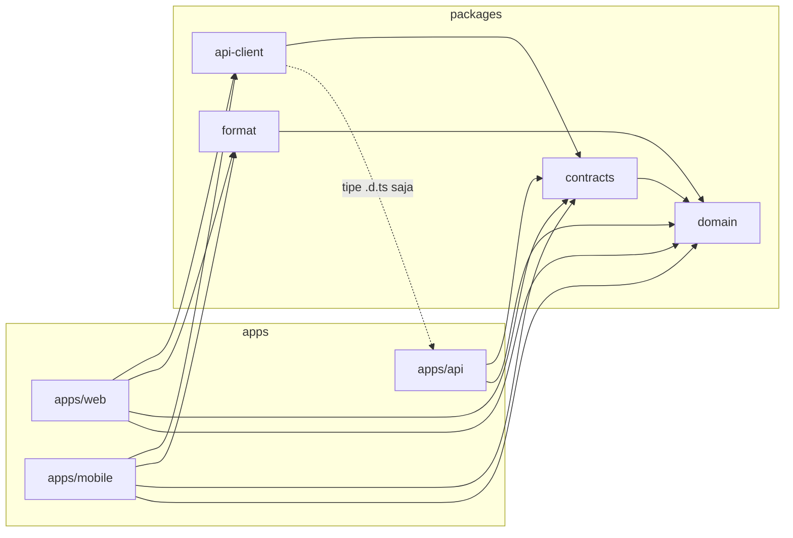
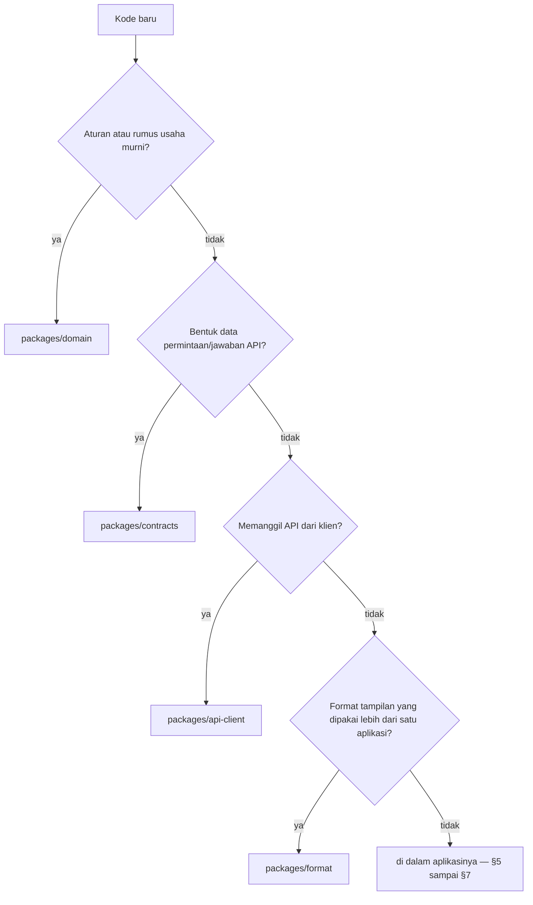
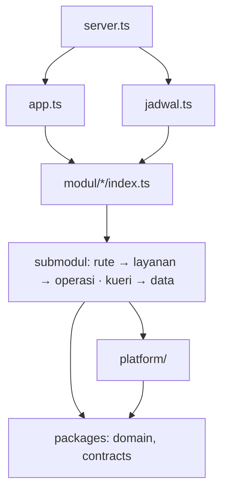

# Pedoman struktur repo

Pedoman pemilik untuk menyusun repo TypeScript: monorepo Bun berisi API
(Hono), web (React + Vite + TanStack Router), dan aplikasi HP (Expo Router).
Disepakati 30 Okt 2026 dari analisis menyeluruh OpenNael; contoh memakai nama
OpenNael. Penerapannya di repo ini — temuan, peta pemindahan, kepemilikan
tabel, urutan kerja — ada di [`struktur.md`](struktur.md).

Proyek baru: salin berkas ini ke `docs/arsitektur/` proyek itu, ganti
`@opennael` dengan nama proyek, lalu ikuti [§12](#12-daftar-periksa).

---

## 1. Prinsip

1. **Satu folder, satu tanggung jawab.** Isi folder bisa dijelaskan dalam
   satu kalimat. Folder "laci campur" (mis. `lib/` berisi transport, sesi,
   data, dan format sekaligus) dipecah.
2. **Domain dulu, lapis kemudian.** Di dalam aplikasi, tingkat pertama adalah
   area domain/produk (`modul/kas`, `fitur/nasabah`); lapis teknis (rute,
   operasi, kueri, komponen) ada di dalamnya. Struktur memperlihatkan apa yang
   dikerjakan sistem, bukan framework-nya.
3. **Ketergantungan satu arah.** Impor hanya ke lapis di bawahnya (§5–§7).
   Antar-modul dan antar-fitur hanya lewat `index.ts`, tanpa siklus.
4. **Satu sumber kebenaran.** Bentuk data API di `contracts`, aturan usaha di
   `domain`, format tampilan bersama di `format`, transport API di
   `api-client`, rancangan database di `docs/skema/`. Kode yang ditulis dua
   kali pada akhirnya berbeda.
5. **Berdampingan.** Uji di sebelah berkas yang diuji, gaya di bawah
   komponennya, bagian privat di dalam folder pemiliknya. Dipindah ke tempat
   bersama baru saat pemakai kedua muncul.
6. **Mulai datar.** Berkas tunggal dulu; jadi folder saat berisi ≥ 3 berkas
   sejenis atau satu berkas melewati ±300 baris (§11).
7. **Batas diperiksa mesin.** Aturan impor ditegakkan Biome dan skrip
   pemeriksa di CI (§10), bukan ingatan.

---

## 2. Penamaan

### 2.1 Bahasa

| Bahasa | Untuk | Contoh |
|---|---|---|
| **Indonesia** | Semua nama yang kita pilih sendiri: folder lapis, domain, berkas, simbol | `modul/`, `fitur/`, `komponen/`, `rute/`, `uji/`, `platform/`, `skema/`, `pembiayaan/`, `kartu-nasabah.tsx`, `buatLayananKas` |
| **Inggris** | Hanya nama yang ditentukan alat atau ekosistem | `apps/`, `packages/`, `src/`, `docs/`, `scripts/`, `assets/`, `lib/` (alias shadcn), `app/` (Expo Router), `_layout.tsx`, `__root.tsx`, `index.ts`, `*.test.ts`, `*.gen.ts`, awalan hook `use…`, nama paket `@opennael/contracts` · `domain` · `api-client` · `format` |

Database mengikuti `docs/skema/README.md`: kata domain Indonesia, akhiran
teknis (`_id`, `_at`) tetap.

### 2.2 Berkas dan simbol

- Berkas dan folder **kebab-case huruf kecil** (`kamera-serah-terima.tsx`).
  Karakter khusus hanya untuk konvensi rute alat (`[id].tsx`, `(tab)`,
  `_bos.tsx`, `$id`).
- **Satu komponen utama per berkas**, ekspor bernama; nama berkas = nama
  komponen dalam kebab-case (`KartuNasabah` → `kartu-nasabah.tsx`).
  `export default` hanya bila diwajibkan alat (berkas rute Expo Router).
- **Badan layar** bernama `layar-<nama>.tsx` dan mengekspor `Layar<Nama>` —
  unik di seluruh repo sehingga mudah dicari.
- **Perakit dependensi** `buat<Nama>(deps)`; tipenya
  `type <Nama> = ReturnType<typeof buat<Nama>>`.
- Dua berkas tidak boleh berbagi nama dasar di folder yang sama (`ikon.ts` +
  `ikon.tsx`): resolusi impor `./ikon` jadi ambigu.

### 2.3 Satu nama untuk satu konsep

Konsep yang sama memakai nama yang sama di semua lapis:

```text
tabel serah_terima_kas
  → docs/skema/schema-serah-terima-kas.md
  → apps/api/src/platform/db/skema/serah-terima-kas.ts
  → modul hari-kolektor/setoran-sore  → contracts/hari-kolektor/setoran-sore.ts
  → fitur setoran-sore (web & HP)
```

- Modul API dinamai menurut **domain**. Fitur UI dinamai menurut **area
  produk** (label menu); bila area itu sama dengan satu modul, pakai nama
  modulnya.
- Hindari nama yang bertabrakan dengan istilah domain. Contoh OpenNael:
  "harian" adalah jenis pinjaman, jadi layar bos `/harian` disimpan di fitur
  `setoran-sore`.
- URL yang sudah beredar tidak diganti demi nama folder; folder mengikuti
  domain dan perbedaannya dicatat di peta struktur proyek.

---

## 3. Monorepo

```text
<proyek>/
├── apps/                    aplikasi yang dijalankan & dirilis; tidak saling mengimpor
│   ├── api/                 server HTTP; satu-satunya yang menyentuh database
│   ├── web/                 SPA React + Vite
│   └── mobile/              aplikasi HP Expo Router
├── packages/                kode bersama, tanpa runtime server
│   ├── domain/              aturan usaha murni
│   ├── contracts/           skema Zod permintaan & jawaban API, galat
│   ├── api-client/          transport, sesi inti, klien bertipe & kunci kueri per modul
│   └── format/              format tampilan murni: uang, tanggal, label
├── docs/                    produk, aturan usaha, keputusan, arsitektur, skema (§9)
├── scripts/                 skrip tingkat repo: rilis, pemeriksa arsitektur
├── .github/workflows/       CI
├── .claude/skills/          skill proyek (satu salinan)
├── AGENTS.md · CLAUDE.md    instruksi agen — satu sumber (§9)
├── package.json             workspaces + skrip gabungan (typecheck, test, lint, format)
├── bun.lock · bunfig.toml
├── tsconfig.base.json       opsi TypeScript bersama; setiap paket meng-extends
└── biome.json               lint, format, batas impor
```

Aturan:

1. `apps/*` hanya bergantung pada `packages/*`. Satu-satunya jembatan
   antar-aplikasi adalah **tipe** API (`@opennael/api/tipe`, berkas `.d.ts`
   hasil `bun run tipe`) yang dipakai `packages/api-client`.
2. Tidak ada impor `../` yang menyeberang batas paket — pakai nama paket.
3. Setiap paket punya `package.json` dengan `exports` (TypeScript langsung,
   tanpa langkah build), `tsconfig.json` yang meng-extends
   `tsconfig.base.json`, skrip `typecheck`, dan `test` bila punya uji.
4. Skrip milik satu paket tinggal di paket itu (`apps/api/scripts/`); skrip
   lintas paket dan rilis di `scripts/` akar. Skrip rilis HP selalu di akar:
   `scripts` di `apps/mobile/package.json` ikut sidik jari runtime.
5. `.env` per aplikasi, tidak di-commit; `.env.example` di-commit.



---

## 4. Paket bersama

| Paket | Isi | Boleh bergantung pada | Tidak boleh berisi |
|---|---|---|---|
| `domain` | rumus & aturan usaha, kalender kantor, galat aturan | — | I/O, jam sistem (`sekarang` selalu parameter), React, Zod |
| `contracts` | skema Zod permintaan & jawaban, galat API; folder mengikuti modul API | `zod`, `domain` (tipe) | logika, I/O |
| `api-client` | transport (token, refresh sekali, `Idempotency-Key`), sesi inti dengan penyimpan yang disuntik aplikasi, klien `hc` per modul, kunci & fungsi kueri | `hono/client`, `contracts`, tipe `@opennael/api/tipe`, `@tanstack/react-query` (peer) | penyimpanan khusus platform, komponen UI |
| `format` | uang, tanggal kantor, label enum, satuan | `domain` (tipe) | React, I/O, warna/kelas tampilan |

Paket baru dibuat saat kode yang sama dibutuhkan dua aplikasi; sebelum itu
kode tinggal di aplikasinya. Berkas `index.ts` paket boleh mengekspor ulang
isinya (pintu masuk paket); `exports` per subjalur ditambah bila bundel HP
perlu dirampingkan.



---

## 5. API (Hono)

```text
apps/api/
├── src/
│   ├── server.ts            titik masuk: baca env → buat db → Bun.serve(app) → mulai jadwal
│   ├── app.ts               perakitan: buatApp(deps) memasang rute semua konteks; export type App
│   ├── jadwal.ts            pekerjaan terjadwal (croner) yang memanggil operasi modul
│   ├── env.ts               skema .env (Zod); server menolak menyala bila salah
│   ├── platform/            kemampuan teknis tanpa aturan usaha; TIDAK mengimpor modul/
│   │   ├── db/              klien · penjaga · skema/<tabel>.ts (+ uji) · migrasi/
│   │   ├── http/            router · pembantu OpenAPI · galat · aktor · wajib-masuk · peran · batas
│   │   ├── idempotensi/
│   │   ├── penyimpanan.ts
│   │   └── riwayat.ts
│   ├── modul/
│   │   └── <konteks>/
│   │       ├── index.ts                     API publik konteks — satu-satunya pintu dari luar
│   │       └── <submodul>/
│   │           ├── rute.ts                  createRoute + handler tipis
│   │           ├── layanan.ts               buatLayanan<X>(deps) → { ...kueri, ...operasi }
│   │           ├── operasi/<kata-kerja>.ts  satu penulisan per berkas
│   │           ├── kueri.ts                 bacaan
│   │           ├── data.ts                  pembantu Drizzle privat
│   │           └── <submodul>.test.ts
│   └── uji/                 pembantu uji
├── scripts/                 skrip khusus API (mis. migrasi database)
├── tipe/                    dihasilkan `bun run tipe`, tidak di-commit
└── drizzle.config.ts · package.json · tsconfig.json · tsconfig.tipe.json · .env.example
```

Konteks yang hanya punya satu submodul boleh datar (isi submodul langsung di
`modul/<konteks>/`). Operasi boleh satu berkas `operasi.ts` selama berisi ≤ 3
operasi dan di bawah ±300 baris; lebih dari itu → folder `operasi/`, satu
operasi per berkas.

| Berkas | Tugas | Dilarang |
|---|---|---|
| `rute.ts` | `createRoute` (skema dari `contracts`) dan handler: ambil aktor, param, kunci idempoten → panggil layanan → `c.json` | logika usaha, Drizzle, skema Zod baru |
| `layanan.ts` | merakit kueri & operasi dengan `deps` (db, `sekarang`, konfigurasi) | logika |
| `operasi/*.ts` | satu transaksi: kunci keadaan → periksa hak/kantor/hari → hitung lewat `domain` → tulis → hasil | `new Date()` langsung (pakai `deps.sekarang`); menulis tabel milik konteks lain |
| `kueri.ts` | bacaan untuk jawaban | menulis |
| `data.ts` | kolom pilihan, pemeta baris, kunci baris (`FOR UPDATE`) | dipakai dari luar konteks |
| `index.ts` | ekspor bernama untuk konteks lain dan `app.ts` | `export *` (yang tidak diekspor = privat) |



Aturan:

1. `platform/` tidak mengimpor `modul/`, `app.ts`, `server.ts`, `jadwal.ts`.
   Yang dibutuhkan platform dari modul (mis. pemeriksa token untuk
   `wajib-masuk`) disuntik saat perakitan.
2. Konteks lain hanya diimpor lewat `modul/<konteks>/index.ts`. Graf
   antar-konteks tanpa siklus dan dicatat di dokumen struktur proyek. Di dalam
   satu konteks, submodul boleh saling impor langsung.
3. **Handler ditulis tepat setelah definisi rutenya** (saran resmi Hono:
   tanpa "controller"). Setiap submodul satu router yang dirangkai berantai,
   dan setiap konteks mengekspor tipe rutenya (`export type Rute<Konteks>`)
   supaya klien RPC tidak memuat satu tipe raksasa.
4. Bentuk permintaan & jawaban — sekecil apa pun — di `contracts`. Pembantu
   definisi rute (`json()`, keamanan bearer, daftar galat, rute tulis baku)
   ada sekali di `platform/http`, tidak disalin per rute.
5. Kunci idempoten dibaca sekali oleh pembantu HTTP lalu diteruskan ke
   operasi; operasi yang idempoten ditandai di modulnya, bukan didaftar sebagai
   string di `app.ts`.
6. **Impor relatif saja di API**: `tsc` tidak menulis ulang alias di berkas
   `.d.ts` yang dibaca klien.
7. **Kepemilikan data**: setiap tabel punya satu konteks pemilik (tabelnya di
   dokumen struktur proyek). Hanya pemilik yang `insert`/`update`/`delete`.
   Konteks lain memanggil operasi publik pemilik dengan `tx` yang sama.
   Membaca tabel lain (`select`) boleh untuk laporan dan validasi; utamakan
   kueri publik pemilik bila ada. Setiap pengecualian dicatat satu per satu.
8. Satu dokumen satu berkas skema: `docs/skema/schema-<tabel>.md` ↔
   `platform/db/skema/<tabel>.ts` ↔ `platform/db/skema/<tabel>.test.ts`.
9. Migrasi yang sudah diterapkan tidak pernah disunting; perubahan lewat
   migrasi baru. Memindah folder migrasi tidak mengubah isinya.

---

## 6. Web (React + Vite + TanStack Router)

```text
apps/web/
├── index.html · vite.config.ts · components.json · package.json · tsconfig.json
└── src/
    ├── main.tsx              createRoot + penyedia (QueryClient, RouterProvider)
    ├── index.css             Tailwind + token tema
    ├── routeTree.gen.ts      dihasilkan plugin TanStack Router — di-commit, jangan disunting
    ├── rute/                 rute berbasis berkas — TIPIS
    │   ├── __root.tsx
    │   ├── masuk.tsx
    │   ├── _bos.tsx          tata letak tanpa jalur: penjaga sesi + kerangka
    │   └── _bos/
    │       ├── index.tsx     → /
    │       └── kas.tsx       → /kas
    ├── fitur/
    │   └── <area>/
    │       ├── layar-<area>.tsx   badan layar yang dirender rute
    │       ├── komponen/          dialog, tabel, panel milik fitur ini
    │       ├── data.ts            hook kueri & mutasi (memakai api-client)
    │       ├── inti.ts            logika murni + inti.test.ts (bila ada)
    │       └── index.ts           ekspor untuk fitur lain (bila ada, sedikit)
    ├── komponen/
    │   ├── ui/                    primitif sistem desain (shadcn, satu per berkas)
    │   └── <bersama>.tsx          komponen lintas fitur tanpa data (tabel-data, formulir)
    └── lib/                       instance & pembantu aplikasi (api.ts, sesi.ts, utils.ts)
```

Arah impor: `rute → fitur → komponen → lib → packages`.

1. **Rute berbasis berkas** (`@tanstack/router-plugin/vite`, dipasang sebelum
   `react()`, dengan `routesDirectory: "./src/rute"` dan
   `autoCodeSplitting: true`). Berkas rute hanya berisi `createFileRoute`
   dengan `validateSearch` (Zod), `beforeLoad` (penjaga), dan `component`
   dari `fitur/`. `routeTree.gen.ts` di-commit dan dikecualikan dari Biome.
2. `komponen/` **tanpa data dan sesi**: tidak mengimpor `fitur/`, `rute/`,
   `lib/api`, `lib/sesi`. Yang butuh sesi (kerangka, tombol keluar) adalah
   fitur (`fitur/akun`).
3. Fitur lain hanya lewat `@/fitur/<nama>` (`index.ts` berisi ekspor bernama,
   sedikit — bukan "barrel" seluruh isi); di dalam fitur sendiri pakai impor
   relatif. Tanpa siklus antar-fitur.
4. Kueri dan mutasi memakai kunci & fungsi dari `api-client`
   (`useQuery(kueri.pengguna.daftar({ peran: "kolektor" }))`), bukan array
   kunci literal di setiap layar.
5. `komponen/ui/` = salinan shadcn/ui, diperlakukan sebagai kode sendiri.
6. Alias `@/` = `src/`.

---

## 7. HP (Expo Router)

```text
apps/mobile/
├── app.json · app.config.ts · eas.json · metro.config.js · .gitignore   ikut sidik jari runtime
├── package.json             `scripts` & modul native ikut sidik jari runtime
├── assets/
└── src/
    ├── app/                 Expo Router — HANYA berkas rute & _layout
    │   ├── _layout.tsx      penyedia + Stack.Protected per sesi/peran
    │   ├── index.tsx        pintu: arahkan ke layar awal
    │   └── <peran>/…        tiap rute ±5–20 baris: baca param → render Layar dari fitur/
    ├── fitur/<area>/        anatomi sama dengan web (layar-*.tsx, komponen/, data.ts, inti/, index.ts)
    ├── komponen/
    │   ├── ui/              sistem desain: tema.ts, tampilan.tsx, daftar-ikon.ts, satu komponen per berkas
    │   └── <bersama>.tsx    komponen lintas fitur tanpa data (lembar-bawah, tab-mengambang)
    ├── platform/            API perangkat non-UI: brankas aman, kompres & unggah foto, info perangkat
    └── lib/                 instance & pembantu aplikasi (api.ts, sesi.ts, navigasi.ts)
```

Arah impor: `app → fitur → komponen → lib → platform → packages`
(`komponen/` tidak mengimpor `lib/` data/sesi maupun `platform/`).

1. `src/app/` **hanya** rute dan `_layout.tsx` (aturan resmi Expo Router):
   rute membaca parameter lalu merender `Layar…` dari `fitur/`. `_layout.tsx`
   boleh berisi konfigurasi navigator.
2. **Penjaga sesi & peran** dengan `Stack.Protected guard={…}` (plus
   `redirectTo`, SDK 58) di satu `_layout.tsx`, bukan `<Redirect>` yang
   disalin per tata letak. Rute pintu (`index.tsx`) tidak dijaga: selama sesi
   belum terbaca ia menampilkan pemuatan, lalu mengarahkan — supaya penjaga
   tidak salah arah. Penjaga ini hanya di klien; server tetap memeriksa peran.
3. `platform/` = API perangkat non-UI. Komponen native yang tampil (mis.
   `CameraView`) tinggal di komponen fiturnya.
4. Gaya: `StyleSheet.create` di bawah berkas komponen; warna, jarak, huruf
   dari token `komponen/ui/tema.ts`.
5. Alias `@/` = `src/` lewat `paths` di `tsconfig.json` (tidak ikut sidik
   jari). Berkas `inti/` yang diuji `bun test` memakai impor relatif.
6. **Sidik jari runtime** (`runtimeVersion: fingerprint`): memindah berkas
   JS/TS tidak mengubahnya; mengubah `scripts` atau modul native di
   `package.json`, `app.json`/`app.config.ts`, `eas.json`, `.gitignore`, atau
   plugin mengubahnya — OTA ke APK terpasang berhenti masuk. Setiap penataan
   dibuktikan:

   ```sh
   cd apps/mobile
   APP_VARIANT=preview bunx @expo/fingerprint fingerprint:generate --platform android > <sementara>/sebelum.json
   # … penataan …
   APP_VARIANT=preview bunx @expo/fingerprint fingerprint:generate --platform android > <sementara>/sesudah.json
   bunx @expo/fingerprint fingerprint:diff <sementara>/sebelum.json <sementara>/sesudah.json   # harus []
   ```

---

## 8. Uji

| Yang diuji | Letak | Cara |
|---|---|---|
| aturan murni (`domain`, `format`, `inti` fitur) | `x.test.ts` di sebelah `x.ts` | `bun test` |
| API per submodul | `modul/<konteks>/<submodul>/<submodul>.test.ts` | `app.request(...)` dalam transaksi database dev yang dibatalkan |
| constraint & trigger database | `platform/db/skema/<tabel>.test.ts` | idem |
| transport & sesi klien | `packages/api-client/src/*.test.ts` | `bun test` dengan `fetch` tiruan |
| pembantu uji | `apps/api/src/uji/` | hanya diimpor berkas `*.test.ts` |
| tampilan | — | typecheck + lint; dicoba pemilik di perangkat |

Nama berkas uji = nama berkas yang diuji (`akad.ts` ↔ `akad.test.ts`); satu
berkas uji tidak menguji banyak modul sekaligus.

---

## 9. Dokumen dan instruksi agen

```text
docs/
├── produk.md                 peran, alur, istilah
├── aturan-usaha.md           rumus & aturan bernomor — acuan domain dan ujinya
├── keputusan.md              keputusan besar: apa, kenapa, yang ditolak (hanya bertambah)
├── arsitektur/
│   ├── README.md             arsitektur & tahapan
│   ├── pedoman-struktur.md   aturan umum struktur (berkas ini)
│   └── struktur.md           penerapan pada proyek ini
└── skema/                    satu dokumen per tabel + konvensi penamaan
```

- Perubahan struktur: `keputusan.md` dulu, lalu `struktur.md`, baru kode.
- **Satu sumber instruksi agen.** Bila dipakai lebih dari satu agen (mis.
  Claude Code + Codex): isi lengkap di `AGENTS.md`; `CLAUDE.md` cukup berisi
  `@AGENTS.md` di baris pertama — impor Claude Code yang berlaku di semua
  sesi, termasuk yang tidak membaca `AGENTS.md` langsung — ditambah hal khusus
  Claude bila ada. Bila hanya Claude: `CLAUDE.md` saja. Dua salinan yang
  disunting terpisah pasti menyimpang.
- **Skill proyek satu salinan.** Claude Code memuat skill dari
  `.claude/skills/`, Codex dari `.agents/skills/`. Keduanya mendukung folder
  symlink, tetapi git di Windows sering memakai `core.symlinks=false` (symlink
  ter-checkout sebagai berkas teks). Maka simpan di `.claude/skills/` dan tulis
  penunjuknya di `AGENTS.md` untuk agen lain.
- Panduan khusus satu aplikasi (mis. panduan Expo) boleh di folder aplikasi
  itu.

---

## 10. Penegakan otomatis

1. **Biome `noRestrictedImports`** (pola gitignore, Biome ≥ 2.2) per folder
   lewat `overrides`. Bekerja pada impor beralias `@/` (web & HP):

   ```json
   {
     "overrides": [
       {
         "includes": ["apps/web/src/komponen/**", "apps/mobile/src/komponen/**"],
         "linter": { "rules": { "style": { "noRestrictedImports": {
           "level": "error",
           "options": { "patterns": [{
             "group": ["@/fitur/**", "@/rute/**", "@/app/**", "@/platform/**", "@/lib/api", "@/lib/sesi"],
             "message": "komponen/ tanpa data dan sesi — pindahkan ke fitur/."
           }] }
         } } } }
       },
       {
         "includes": ["apps/web/src/fitur/**", "apps/mobile/src/fitur/**"],
         "linter": { "rules": { "style": { "noRestrictedImports": {
           "level": "error",
           "options": { "patterns": [{
             "group": ["@/fitur/*/**", "@/rute/**", "@/app/**"],
             "message": "Fitur lain hanya lewat @/fitur/<nama>; fitur tidak mengimpor rute."
           }] }
         } } } }
       }
     ]
   }
   ```

2. **`scripts/cek-arsitektur.ts`** untuk aturan yang tidak bisa dinyatakan
   dengan pola (impor relatif API, siklus, penulisan tabel). Memakai
   TypeScript compiler API (sudah terpasang) dan memeriksa:
   - `apps/api/src/platform/**` tidak mengimpor `modul/`, `app.ts`,
     `server.ts`, `jadwal.ts`;
   - impor antar-konteks API hanya ke `modul/<konteks>/index.ts`;
   - tidak ada siklus antar-konteks API maupun antar-fitur web/HP;
   - `.insert/.update/.delete(<tabel>)` hanya di konteks pemilik (peta
     pemilik dibaca dari satu berkas data yang sama dengan dokumen struktur);
   - tidak ada `../` yang menyeberang batas paket.
3. **CI** (`.github/workflows/`): `bun install --frozen-lockfile`, typecheck,
   test, lint, cek arsitektur. Tanpa merge, migrasi, atau rilis otomatis.

---

## 11. Ukuran dan kapan memecah

| Tanda | Tindakan |
|---|---|
| Berkas > ±300 baris atau memegang > 1 tanggung jawab | pecah: komponen ke `komponen/`, logika ke `inti`, data ke `data.ts`, penulisan ke `operasi/` |
| ≥ 3 berkas sejenis di satu tempat | jadikan folder |
| Folder > ±10 berkas | kelompokkan per sub-area |
| `index.ts` publik > ±10 ekspor | konteks/fitur mungkin terlalu besar — pecah |
| Konteks hanya punya satu submodul | datarkan |
| Pemakai kedua muncul | baru pindahkan ke tempat bersama (`komponen/`, `lib/`, `packages/`) |

---

## 12. Daftar periksa

### Proyek baru

1. Akar: `package.json` (`"workspaces": ["apps/*", "packages/*"]`, skrip
   `typecheck`/`test`/`lint`/`format`), `bunfig.toml` (`linker = "hoisted"`
   bila ada Expo), `tsconfig.base.json` (`strict`), `biome.json` (+ §10),
   `.gitignore`, `.gitattributes` (LF).
2. `docs/`: produk, aturan-usaha, keputusan, `arsitektur/` (README,
   pedoman-struktur, struktur), `skema/README.md`.
3. `packages/domain` dan `packages/contracts` sejak awal; `api-client` saat
   klien pertama memanggil API; `format` saat aplikasi kedua butuh format yang
   sama.
4. `apps/api`: `server.ts`, `app.ts`, `env.ts`, `platform/{db,http}`,
   `modul/`, `uji/`.
5. `apps/web`: Vite React TS + plugin TanStack Router (`src/rute`), shadcn ke
   `src/komponen/ui`, alias `@/`.
6. `apps/mobile`: `create-expo-app`, rute di `src/app`, alias `@/`,
   `fitur/`, `komponen/ui/`, `platform/`, `lib/`.
7. CI (§10).

### Modul API baru

1. Tabelnya ada di `docs/skema/` dan sudah dibangun (skill `tabel-baru`).
2. Tentukan konteks pemilik; tambah barisnya di tabel kepemilikan.
3. Bentuk data di `contracts/<konteks>/<submodul>.ts`.
4. Submodul: `rute.ts`, `layanan.ts`, `operasi/`, `kueri.ts`, uji.
5. Ekspor yang dibutuhkan konteks lain lewat `index.ts`; pasang di `app.ts`.
6. Klien & kunci kueri di `api-client`.

### Fitur UI baru

1. Berkas rute tipis di `rute/` (web) atau `app/` (HP).
2. `fitur/<area>/layar-<nama>.tsx`, `data.ts` (kueri dari `api-client`),
   `komponen/`, dan `inti` + uji bila ada logika murni.
3. Komponen yang dipakai fitur kedua: tanpa data → `komponen/`; dengan data →
   diekspor dari `index.ts` fitur pemiliknya.

---

## 13. Anti-pola

Contoh nyata dari OpenNael sebelum ditata (rincian di
[`struktur.md`](struktur.md) §2).

| Anti-pola | Contoh | Ganti dengan |
|---|---|---|
| Folder laci campur | akar `src/` API berisi env, galat, batas, rem, riwayat, penyimpanan berjajar | `platform/` + `domain` |
| Milik bersama disimpan di modul lain | kalender kantor di `lapangan/gerbang.ts`, diimpor 12 modul | konteks pemilik (`kantor/kalender`) |
| Layar raksasa | `layar/pengaturan.tsx` 1.100 baris | `fitur/<area>/komponen/` + `data.ts` |
| Layar mengekspor bagian untuk layar lain | `layar/aktivitas.tsx` mengekspor `LABEL_PERAN`, `DialogRiwayat` | `index.ts` fitur pemilik; label ke `format` |
| Pembantu disalin per berkas | `const json = …` di 20 `rute.ts` | `platform/http` |
| Kueri disalin | kueri daftar kolektor 8× di web | kunci kueri di `api-client` |
| Transport disalin per aplikasi | `lib/api.ts` & `lib/sesi.ts` web dan HP | `packages/api-client` |
| Komponen bersama memanggil API | `komponen/keluar.tsx` memakai `lib/api` & `lib/sesi` | komponen fitur (`fitur/akun`) |
| Lapis bawah mengimpor lapis atas | `platform/idempotensi` → `modul/auth/token`; `inti/` → `ui/` | tipe di lapis bawah |
| Penjaga disalin | tiga `_layout.tsx` peran | `Stack.Protected` |
| Skrip menembus paket | `tooling/migrer.ts` → `../apps/api/src` | `apps/api/scripts/` |
| Dua salinan instruksi | `CLAUDE.md` vs `AGENTS.md` sudah menyimpang | satu sumber + impor |

---

## 14. Rujukan

- Hono — [Best Practices](https://hono.dev/docs/guides/best-practices)
  (tanpa controller, `app.route()` per berkas, rantai untuk RPC).
- Expo — [App folder structure best practices](https://expo.dev/blog/expo-app-folder-structure-best-practices),
  [Protected routes](https://docs.expo.dev/router/advanced/protected/),
  [Fingerprint](https://docs.expo.dev/versions/v58.0.0/sdk/fingerprint/).
- TanStack Router — [File-based routing](https://tanstack.com/router/latest/docs/framework/react/routing/file-based-routing),
  [File naming conventions](https://tanstack.com/router/latest/docs/framework/react/routing/file-naming-conventions),
  [Instalasi dengan Vite](https://tanstack.com/router/latest/docs/framework/react/installation/with-vite).
- [Bulletproof React — project structure](https://github.com/alan2207/bulletproof-react/blob/master/docs/project-structure.md)
  (fitur, arah satu jalur, tanpa barrel besar).
- Turborepo — [Structuring a repository](https://turborepo.dev/docs/crafting-your-repository/structuring-a-repository)
  (`apps/` + `packages/`, batas paket, `exports`).
- [Node.js Best Practices — structure by components](https://github.com/goldbergyoni/nodebestpractices/blob/master/sections/projectstructre/breakintcomponents.md).
- Biome — [noRestrictedImports](https://biomejs.dev/linter/rules/no-restricted-imports/).
