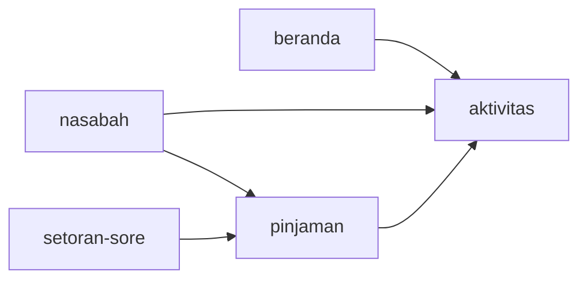
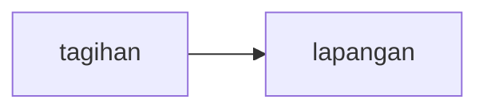
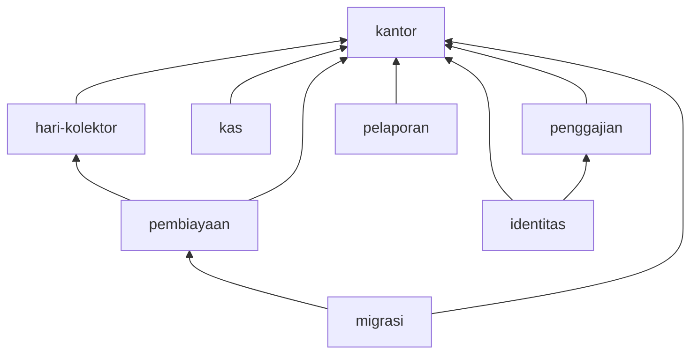

# Struktur OpenNael

Disetujui pemilik 30 Okt 2026. Dokumen ini menerapkan
[`pedoman-struktur.md`](pedoman-struktur.md) pada OpenNael dan menyempurnakan
"Susunan tujuan" di [`README.md`](README.md) untuk tahap 3–5. Aturan umum ada
di pedoman dan tidak diulang; di sini: keputusan, temuan, target, batas API,
peta pemindahan, urutan kerja, dan gerbang verifikasi.

> **Untuk eksekutor.** Baca §1, §6, §7 sebelum menyentuh berkas. Kerjakan
> langkah §6 berurutan; satu langkah = satu atau beberapa commit yang lolos
> gerbang §7, lalu push ke `origin/dev`. Pindahkan dulu dengan perilaku sama,
> ubah perilaku di commit terpisah. URL API, URL aplikasi, dan teks yang
> tampil tidak berubah. Jangan merge ke `main`, jangan OTA, jangan sunting
> migrasi yang sudah diterapkan, jangan ubah `scripts` atau `.gitignore` di
> `apps/mobile`. Ragu → tanya pemilik.

---

## 1. Keputusan 30 Okt 2026

| # | Keputusan | Menggantikan |
|---|---|---|
| K1 | Nama folder bahasa Indonesia; Inggris hanya nama yang ditentukan alat/ekosistem ([pedoman §2.1](pedoman-struktur.md#21-bahasa)). | `entrypoints/`, `bootstrap/`, `tooling/` di README |
| K2 | API: `src/server.ts` (titik masuk), `src/app.ts` (perakitan), `src/jadwal.ts` (cron) di akar `src/`. Folder dibuat bila berisi ≥ 3 berkas sejenis. | folder `entrypoints/` & `bootstrap/` |
| K3 | `scripts/` akar untuk skrip repo; skrip milik satu paket di paket itu: `tooling/migrer.ts` → `apps/api/scripts/migrasi.ts`. `tooling/` dihapus. | `tooling/` |
| K4 | Paket baru `packages/format` untuk format tampilan bersama web & HP. | format ganda per aplikasi |
| K5 | Web memakai rute berbasis berkas TanStack Router di `src/rute/`. | `src/rute.tsx` berbasis kode |
| K6 | Instruksi agen satu sumber: `AGENTS.md` berisi lengkap, `CLAUDE.md` hanya `@AGENTS.md`. Skill proyek satu salinan di `.claude/skills/`; `AGENTS.md` menunjuk Codex ke sana. Codex = agen cadangan saat batas Claude Code habis. | `CLAUDE.md` + `AGENTS.md` yang disunting terpisah; salinan skill di `.agents/skills/` |

Tetap seperti README: modular monolith, satu PostgreSQL, konteks API
(identitas, kantor, hari-kolektor, pembiayaan, kas, penggajian, pelaporan,
migrasi), `packages/api-client`, aturan transaksi uang, CI tanpa
merge/OTA/migrasi otomatis.

---

## 2. Temuan analisis (29–30 Okt 2026)

Dibaca hanya-baca, berurutan api → web → mobile, pada `dev` commit `31ef4f5`
ditambah pekerjaan `lapangan/` yang belum di-commit. Ukuran: API 18.970 baris
TS (tanpa migrasi, termasuk uji), web 8.244, HP 9.468, packages 3.513.

### 2.1 Akar repo

| Temuan | Bukti |
|---|---|
| Dua folder skrip | `scripts/kirim-ota.ts` dan `tooling/migrer.ts` |
| Skrip menembus batas paket | `tooling/migrer.ts` mengimpor `../apps/api/src/db/penjaga`; komentarnya berbahasa Prancis |
| Instruksi agen ganda | `AGENTS.md` (belum di-commit) = salinan `CLAUDE.md` yang sudah menyimpang (tanpa baris mode gelap & Lucide, jalur `.Codex/skills`); `.agents/skills/tabel-baru/SKILL.md` = salinan persis `.claude/skills/tabel-baru/SKILL.md` |
| Belum ada CI | tidak ada `.github/` |
| Berkas sementara | `tooling/pecah-lapangan.tmp.ts` (codemod, belum di-commit) |

### 2.2 apps/api

| Temuan | Bukti |
|---|---|
| Akar `src/` = laci campur | 10 berkas lepas berbeda tugas: `app`, `server`, `router`, `env`, `galat`, `batas`, `penyimpanan`, `peran`, `rem`, `riwayat`; ditambah `db/`, `platform/idempotensi/`, `uji/` |
| Aturan murni di API | `rem.ts` (`gabungRem`) tanpa I/O — milik `packages/domain` |
| 22 modul datar, kepemilikan kabur | kalender kantor (`bacaKalender`, `hariTagihAntara`) tinggal di `lapangan/gerbang.ts` dan diimpor **12 modul**; pembantu `lapangan` (`pastikanWilayah`, `keKartu`, `kolomKartu`, `kolomRem`, `daftarkanNasabahBaru`, `pinjamanKeBerikut`) diimpor 4 modul; `setoran-sore/kunci-hari.ts` diimpor `pembatalan` |
| Modul raksasa | `lapangan/layanan.ts` 865 baris di HEAD (sedang dipecah), `setoran-sore/layanan.ts` 742, `pengaturan/layanan.ts` 641 berisi 5 urusan (kantor, pekan kerja, rem, libur kantor, tarif gaji), `aktivitas/layanan.ts` 605 |
| Lapis bawah mengimpor lapis atas | `platform/idempotensi` mengimpor `modul/auth/token` (tipe `Aktor`); hampir semua modul mengimpor `auth/token`, `auth/wajib-masuk`, `auth/layanan` |
| Pembantu disalin | `const json = …` di 20 `rute.ts`; `const aman = …` 13×; `router.use(…, wajibMasuk(auth))` 34×; `c.req.header("Idempotency-Key")` di setiap handler 7 modul (gaji, kas, lapangan, migrasi, pembatalan, setoran-sore, tabungan); `deps.sekarang ?? (() => new Date())` di setiap layanan dan kini di setiap berkas operasi |
| Bentuk data di luar `contracts` | `z.object(…)` jawaban ditulis langsung di 16 `rute.ts` |
| Idempotensi lewat daftar nama | `app.ts` mendaftar metode idempoten sebagai string (`["absen", "bukaLaporan", …]`) |
| Penulisan lintas pemilik | 6 tempat — §4.3 |
| Uji menumpuk | `db/skema.test.ts` 1.808 baris untuk semua tabel; `app.test.ts` menguji app, env, kalender gerbang, dan penjaga sekaligus |
| Sudah baik | modul berfolder dengan uji berdampingan; skema Drizzle per tabel (kecuali `kas.ts` 3 tabel, `libur.ts` 2, `tabungan.ts` 2); galat terpusat; env divalidasi |

### 2.3 apps/web

| Temuan | Bukti |
|---|---|
| Layar raksasa datar | `src/layar/` 15 berkas: `pengaturan` 1.100 baris, `harian` 915, `nasabah-detail` 719, `kas` 687 — kueri, mutasi, dialog, tabel dalam satu berkas |
| Layar saling mengimpor | 9 impor antar-layar: `aktivitas` mengekspor `LABEL_PERAN`, `DialogRiwayat`, `DaftarAktivitas`; `nasabah-pinjaman` mengekspor `DialogPinjaman`, `TabPinjaman`, `TabPeristiwa`, `DialogHapusLibur`; `nasabah-detail` mengekspor `DialogNasabah` |
| Semua rute satu berkas | `src/rute.tsx` 187 baris, berbasis kode, validasi pencarian ditulis tangan |
| Kueri disalin | kueri daftar kolektor (`["pengguna", "kolektor"]` + fungsi sama) 8×; kunci kueri literal di setiap layar |
| Pembantu disalin | `useTenang` 2× (`nasabah`, `salin-buku`) |
| Tipe didefinisikan ulang | `lib/format.ts` mendefinisikan ulang `StatusPinjaman` |
| Komponen bersama memakai sesi | `komponen/kerangka.tsx` mengimpor `lib/api` & `lib/sesi` |
| Satu tipe API raksasa | `hc<App>` untuk seluruh API (CLAUDE.md menghendaki klien per modul) |
| Sudah baik | alias `@/`, `komponen/ui/` shadcn per berkas, layar dimuat per rute |

### 2.4 apps/mobile

| Temuan | Bukti |
|---|---|
| Rute berisi layar penuh | `app/kolektor/(tab)/tagihan.tsx` 478 baris, `gulung/[id]` 458, `akad` 315, `bayar/[id]` 285, `tautkan` 271, `pinjaman/[id]` 249, `kasir/[kolektorId]` 237, `(tab)/index` 221; `pengawas/cocokkan` & `pengawas/tunggakan` memanggil `lib/api` langsung |
| Penjaga peran disalin | logika `<Redirect>` sama di `kasir/`, `kolektor/`, `pengawas/` `_layout.tsx` |
| `komponen/` campur | sistem desain (`ui.tsx` 657 baris ±20 komponen, `tema`, `tampilan`, `ikon`) bercampur komponen domain (`foto-nasabah`, `kamera-serah-terima`, `rincian-kas`, `keluar`, `kepala-peran`) yang mengimpor `lib/api`, `lib/sesi`, `lib/foto`, `lib/setoran` |
| `lib/` laci campur | transport (`api`), sesi, data per domain (`lapangan`, `setoran`), perangkat (`foto`, `perangkat`), format, navigasi (`peran`) |
| Fitur saling menembus | `fitur/semua` mengimpor isi `fitur/tagihan/inti/*` dan `fitur/mode`; `tagihan/inti/kabar-tercatat.ts` mengimpor tipe dari `tagihan/ui/kartu-nasabah.tsx` (inti → ui); layar Bayar & Gulung memakai `tagihan/inti/papan` dan `tagihan/ui/papan-tombol` padahal papan itu milik layar transaksi — menyisakannya di `tagihan` akan membuat siklus `tagihan ↔ lapangan` |
| Impor relatif dalam | sampai `../../../`, tanpa alias |
| Sudah baik | `fitur/tagihan` berpola `inti/` (murni + uji) dan `ui/`; token tema & mode gelap lewat hook; penjaga path di `metro.config.js` |

Sidik jari runtime `preview` Android saat dokumen ini ditulis:
`654c5ebcdac265c382ca036e6f1474b2e3968650` (`@expo/fingerprint` 0.21.6);
`apps/mobile/.gitignore` termasuk sumbernya.

### 2.5 Duplikasi web ↔ HP

| Hal | Web | HP |
|---|---|---|
| refresh token sekali + `ambilDenganSesi` + `panggil` | `lib/api.ts` | `lib/api.ts` (hampir identik) |
| toko sesi (`ambil/simpan/gantiToken/hapus/dengar`) | `lib/sesi.ts` (localStorage) | `lib/sesi.ts` (SecureStore) |
| `rupiah`, nama bulan & hari, `namaTenor`, label jenis pinjaman | `lib/format.ts` | `lib/format.ts` (bentuk tanggal sudah berbeda) |
| label jenis transaksi (angsuran/pelunasan/gulung) | `layar/harian.tsx` | `app/kasir/[kolektorId].tsx` |
| `hariIniKantor(zona)` | `lib/kantor.ts` | `lib/peran.ts` |

---

## 3. Struktur target

### 3.1 Akar

```text
opennael/
├── apps/{api, web, mobile}
├── packages/{domain, contracts, api-client, format}
├── docs/
│   ├── produk.md · aturan-usaha.md · keputusan.md
│   ├── arsitektur/{README.md, pedoman-struktur.md, struktur.md}
│   └── skema/
├── scripts/
│   ├── kirim-ota.ts                 tetap
│   └── cek-arsitektur.ts            baru (langkah 9)
├── .github/workflows/periksa.yml    baru (langkah 9)
├── .claude/skills/tabel-baru/       jalur di dalamnya diperbarui (§8)
├── AGENTS.md                        sumber tunggal instruksi agen (langkah 1)
├── CLAUDE.md                        hanya `@AGENTS.md`
└── package.json · bun.lock · bunfig.toml · tsconfig.base.json · biome.json
```

### 3.2 packages/

```text
packages/
├── domain/src/            datar per topik; + rem.ts (dari API);
│                          pinjaman.test.ts dipecah → akad.test.ts · gulung.test.ts · setoran.test.ts
├── contracts/src/         mengikuti konteks API
│   ├── index.ts           tetap mengekspor semuanya — pemakai tidak berubah
│   ├── bersama/           galat · idempotensi · sehat
│   ├── identitas/         auth · tautan · perangkat · pengguna
│   ├── kantor/            profil · kalender · kebijakan · wilayah
│   ├── hari-kolektor/     absensi · setoran-sore · rute-kolektor
│   ├── pembiayaan/        nasabah · akad · pinjaman · peristiwa · tabungan · pemutihan · pembatalan · foto
│   ├── kas.ts
│   ├── penggajian/        gaji · tarif
│   ├── pelaporan/         ringkasan · aktivitas
│   └── migrasi.ts
├── api-client/            baru
│   ├── package.json       "@opennael/api-client"; exports "." (+ per konteks bila perlu);
│   │                      peer @tanstack/react-query; dev @opennael/api (tipe)
│   └── src/
│       ├── transport.ts   fetch bersesi: token akses, refresh sekali dibagi, Idempotency-Key + ulang dengan kunci sama
│       ├── panggil.ts     panggil · ambil · galat → Error berpesan · PESAN_JARINGAN
│       ├── sesi.ts        buatSesi(penyimpan) — penyimpan disuntik aplikasi
│       ├── <konteks>.ts   klien hc per konteks + kueri.<x>() (queryOptions) + tulis.<x>()
│       └── *.test.ts
└── format/                baru
    └── src/
        ├── uang.ts        rupiah · angka · persen · bacaUang · tulisUang
        ├── tanggal.ts     tanggal (tanpa/pendek/panjang nama hari) · tanggalPendek · tanggalBertahun · jam · waktu · waktuPendek
        ├── label.ts       jenis & status pinjaman · peran · jenis transaksi · peristiwa · namaTenor
        └── *.test.ts
```

### 3.3 apps/api

```text
apps/api/
├── drizzle.config.ts            schema ./src/platform/db/skema/index.ts · out ./src/platform/db/migrasi
├── package.json                 db:migrate → bun scripts/migrasi.ts
├── scripts/migrasi.ts           dari tooling/migrer.ts
└── src/
    ├── server.ts · app.ts · jadwal.ts · env.ts
    ├── app.test.ts · env.test.ts
    ├── platform/
    │   ├── db/
    │   │   ├── klien.ts · penjaga.ts · penjaga.test.ts
    │   │   ├── skema/           index.ts · kolom.ts · <tabel>.ts × 29 · <tabel>.test.ts
    │   │   └── migrasi/         0000…0023 + meta/ — dipindah utuh
    │   ├── http/                router · openapi · galat · aktor · wajib-masuk · peran · batas
    │   ├── idempotensi/         index.ts · idempotensi.test.ts
    │   ├── penyimpanan.ts
    │   ├── riwayat.ts
    │   └── log.ts               tahap 5 (pino)
    ├── modul/
    │   ├── identitas/           index.ts · auth/ · tautan/ · perangkat/ · pengguna/
    │   ├── kantor/              index.ts · profil/ · kalender/ · kebijakan/ · wilayah/
    │   ├── hari-kolektor/       index.ts · gerbang.ts · absensi/ · setoran-sore/ · rute-kolektor/
    │   ├── pembiayaan/          index.ts · nasabah/ · akad/ · pinjaman/ · peristiwa/ · tabungan/
    │   │                        pemutihan/ · pembatalan/ · foto/ · tutup-hari/
    │   ├── kas/                 datar: index.ts · rute.ts · layanan.ts · saldo.ts · kas.test.ts
    │   ├── penggajian/          index.ts · gaji/ · tarif/
    │   ├── pelaporan/           index.ts · ringkasan/ · aktivitas/
    │   └── migrasi/             datar
    └── uji/                     bantu.ts · skema.ts (pembantu uji skema)
```

`hari-kolektor/absensi` = absen pagi, keadaan hari ini, buka laporan (akhir
kerja lapangan). `modul/migrasi` = salin buku lama; `platform/db/migrasi` =
migrasi skema — dua arti berbeda, dibedakan oleh lapisnya.

### 3.4 apps/web

```text
apps/web/src/
├── main.tsx                    createRouter({ routeTree }) + penyedia + Register; sesi.dengar → router.invalidate
├── index.css
├── routeTree.gen.ts            dihasilkan plugin; di-commit; dikecualikan Biome
├── rute/                       tabel URL di §5.4
│   ├── __root.tsx · masuk.tsx · daftar.tsx · _bos.tsx
│   └── _bos/  index · aktivitas · harian · nasabah/{index, salin} · pinjaman · kas · gaji · karyawan · tautkan · pengaturan
├── fitur/
│   ├── akun/                   layar-masuk · layar-daftar · kerangka
│   ├── beranda/                layar-beranda · komponen/ · data.ts
│   ├── aktivitas/              layar-aktivitas · komponen/ · data.ts · index.ts
│   ├── setoran-sore/           layar-harian · komponen/ · data.ts
│   ├── nasabah/                layar-nasabah · komponen/ · data.ts
│   ├── pinjaman/               layar-pinjaman · komponen/ · data.ts · index.ts
│   ├── salin-buku/             layar-salin-buku · komponen/ · inti.ts · data.ts
│   ├── kas/ · gaji/ · karyawan/ · tautan/ · pengaturan/
├── komponen/
│   ├── ui/                     badge · button · card · dialog · input · label · table · tabs · textarea
│   └── tabel-data · formulir · halaman · dialog-batal · dialog-formulir · isian-rupiah
└── lib/
    ├── api.ts                  klien @opennael/api-client (alamat /api, penyimpan localStorage)
    ├── sesi.ts                 useSesi
    ├── kantor.ts               useKantor · useHariIni
    ├── pencarian.ts            skema Zod pencarian bersama (tanggal, teks)
    ├── tenang.ts               useTenang
    └── utils.ts                cn (shadcn)
```



Panah = impor lewat `@/fitur/<nama>`. Fitur lain tidak saling mengimpor.

### 3.5 apps/mobile

```text
apps/mobile/src/
├── app/                         URL tetap — tabel di §5.5
│   ├── _layout.tsx              penyedia + Stack.Protected (tautkan · beranda · kolektor · kasir · pengawas)
│   ├── index.tsx                pintu tanpa penjaga: layar memuat selama sesi undefined, lalu arahkan
│   ├── tautkan.tsx · beranda.tsx
│   ├── kolektor/                _layout · (tab)/{_layout, index, tagihan, notifikasi} · akad · bayar/[id] · gulung/[id] · pinjaman/[id]
│   ├── kasir/                   _layout · index · [kolektorId]
│   └── pengawas/                _layout · index · cocokkan · tunggakan
├── fitur/
│   ├── tautan/                  layar-tautkan · komponen/
│   ├── lapangan/                data.ts · gerbang.ts · kabar-tercatat.ts · inti/papan.ts · index.ts
│   │                            layar-beranda · layar-akad · layar-bayar · layar-gulung · layar-pinjaman · komponen/
│   ├── tagihan/                 layar-tagihan · layar-semua · mode.ts · inti/ · komponen/ · index.ts
│   ├── notifikasi/              layar-notifikasi
│   ├── setoran-sore/            data.ts · inti.ts · layar-kasir · layar-kas-kolektor · layar-pengawas · komponen/
│   ├── pencocokan-kas/          layar-cocokkan · data.ts
│   ├── tunggakan/               layar-tunggakan · data.ts
│   └── akun/                    layar-beranda-bos · komponen/{tombol-keluar, kepala-peran}
├── komponen/
│   ├── ui/                      tema.ts · tampilan.tsx · daftar-ikon.ts · ikon.tsx · gaya-bersama.ts
│   │                            layar · teks · tombol · isian · kartu · lencana · spanduk · pilihan
│   └── lembar-bawah.tsx · tab-mengambang.tsx · pilih-tampilan.tsx
├── platform/                    brankas.ts (SecureStore) · foto.ts (kompres + unggah) · perangkat.ts (info & versi)
└── lib/                         api.ts · sesi.ts · kantor.ts · navigasi.ts · aturan.ts
```



Satu-satunya impor antar-fitur HP: `tagihan` memakai data lapangan,
`kabarTercatat`, dan tipe `Stempel` lewat `@/fitur/lapangan`. Tata letak tab
kolektor (rute) memakai `@/fitur/tagihan` (mode) dan `@/fitur/lapangan`
(gerbang).

Sketsa penjaga (periksa API `Stack.Protected` di dokumen SDK 58 saat
mengerjakan):

```tsx
// src/app/_layout.tsx — di dalam penyedia
const s = useSesi();
const peran = s?.pengguna.peran;
<Stack screenOptions={{ headerShown: false, contentStyle: { backgroundColor: WARNA.latar } }}>
  <Stack.Screen name="index" />
  <Stack.Protected guard={!s}>
    <Stack.Screen name="tautkan" />
  </Stack.Protected>
  <Stack.Protected guard={peran === "kolektor"}>
    <Stack.Screen name="kolektor" />
  </Stack.Protected>
  {/* kasir, pengawas, beranda (bos) dengan pola sama */}
</Stack>
```

---

## 4. Batas API

### 4.1 Graf konteks



Panah = boleh mengimpor `index.ts` konteks tujuan. Membaca tabel konteks lain
(`select`) tidak memerlukan panah. `platform/` di bawah semuanya; `app.ts` dan
`jadwal.ts` di atas semuanya. Panah baru yang membuat siklus ditolak.

Ekspor publik yang sudah pasti:

| Konteks | `index.ts` mengekspor (selain perakit rute & layanan) |
|---|---|
| kantor | `bacaKalender`, `hariTagihAntara`, `kalenderGerbang`, `VALIDASI_PENUH`, tipe `KalenderHari` & `ValidasiKalender`, `pastikanWilayah`, kolom & rem berlaku kebijakan, operasi buka kantor & klaim tanggal tutup |
| hari-kolektor | `bukaGerbang`, `kasSudahDiterima`, operasi batal transfer milik transaksi |
| pembiayaan | operasi untuk migrasi (`daftarkanNasabahBaru`, `pinjamanKeBerikut`, salin pinjaman), perakit tutup hari untuk `jadwal.ts` |
| penggajian | operasi tarif awal kantor baru |

### 4.2 Kepemilikan tabel

| Konteks | Tabel milik (30 tabel) | Submodul penulis |
|---|---|---|
| identitas | `pengguna`, `perangkat`, `tautan` | auth, tautan, perangkat, pengguna |
| kantor | `kantor`, `pekan_kerja`, `libur_kantor`, `kebijakan`, `wilayah` | profil, kalender, kebijakan, wilayah |
| hari-kolektor | `hari_kolektor`, `serah_terima_kas`, `transfer_setoran`, `biaya_tak_terduga`, `rute_kolektor`, `rute_wilayah` | absensi, setoran-sore, rute-kolektor |
| pembiayaan | `nasabah`, `pinjaman`, `transaksi`, `libur_nasabah`, `riwayat_status_pinjaman` (trigger), `koreksi_tabungan`, `penarikan_tabungan`, `foto`, `posisi_harian` | nasabah, akad, pinjaman, peristiwa, tabungan, pemutihan, pembatalan, foto, tutup-hari |
| kas | `buku_kas`, `mutasi_kas_kantor`, `pencocokan_kas` | kas |
| penggajian | `tarif_gaji`, `pembayaran_gaji` | tarif, gaji |
| platform | `riwayat_perubahan`, `operasi_idempoten` | `riwayat.ts`, `idempotensi/` |
| pelaporan, migrasi | — | pelaporan hanya membaca; migrasi lewat operasi pembiayaan |

Peta ini juga menjadi data `scripts/cek-arsitektur.ts` (langkah 9).

### 4.3 Penulisan lintas pemilik (dibereskan di langkah 3c)

| Penulis sekarang | Menulis | Pemilik | Penyelesaian |
|---|---|---|---|
| `auth` — registrasi kantor | `kantor`, `pekan_kerja`, `tarif_gaji` | kantor, penggajian | operasi publik kantor (buka kantor + pekan kerja awal) dan penggajian (tarif awal), dipanggil dengan `tx` yang sama |
| `lapangan` — akad (`pastikanWilayah`) | `wilayah` | kantor | `pastikanWilayah` dari `kantor/index.ts` |
| `pembatalan` — batal transaksi | `transfer_setoran` | hari-kolektor | operasi publik hari-kolektor yang membatalkan transfer milik transaksi itu |
| `tutup-hari` | `kantor.tanggal_tutup_terakhir` | kantor | operasi publik kantor (klaim tanggal tutup) |
| `migrasi` | `pinjaman`, `nasabah` | pembiayaan | operasi publik pembiayaan |
| `wilayah` — gabung/hapus kampung | `nasabah.wilayah_id`, `rute_wilayah`, `rute_kolektor` | pembiayaan, hari-kolektor | **pengecualian tercatat**: pemilik baris yang dirujuk boleh memindahkan atau menghapus rujukan ke barisnya (termasuk menaikkan versi rute yang terdampak) dalam transaksi yang sama. Memanggil operasi pembiayaan/hari-kolektor dari kantor akan membuat siklus. |

---

## 5. Peta pemindahan

Kolom "Asal" memakai jalur sekarang. Nama komponen dan fungsi tetap kecuali
disebut; yang berubah hanya letak dan impor.

### 5.1 Akar

| Asal | Target |
|---|---|
| `tooling/migrer.ts` | `apps/api/scripts/migrasi.ts` (komentar bahasa Indonesia; impor `../src/platform/db/penjaga`); sesuaikan `new URL(…)`: `cwd` → `".."` (folder `apps/api`), biner → `"../../../node_modules/drizzle-kit/bin.cjs"` (node_modules akar, `linker = "hoisted"`); skrip `db:migrate` di `apps/api/package.json` → `bun scripts/migrasi.ts` |
| `tooling/pecah-lapangan.tmp.ts` | dihapus di langkah 0 (§6.1), tidak pernah di-commit |
| `tooling/` | dihapus |
| `scripts/kirim-ota.ts` | tetap |
| `AGENTS.md` (belum di-commit, sudah menyimpang) | ditulis ulang dari isi `CLAUDE.md` terbaru lalu di-commit — sumber tunggal instruksi (K6, rincian §6.2) |
| `CLAUDE.md` | hanya `@AGENTS.md` |
| `.agents/` (belum di-commit) | dihapus — skill tetap satu salinan di `.claude/skills/` |
| komentar `apps/mobile/app.config.ts` baris 6 ("… di CLAUDE.md") | "… di AGENTS.md" (sidik jari meng-hash isi konfigurasi, bukan komentar — dibuktikan G4) |
| `biome.json` | `files.includes` + `"!**/routeTree.gen.ts"`; aturan batas di langkah 9 |

### 5.2 apps/api

**Akar & platform**

| Asal | Target |
|---|---|
| `src/server.ts` | tetap; penjadwal dipanggil dari `src/jadwal.ts` |
| `src/app.ts` | tetap; impor konteks hanya lewat `modul/<konteks>/index.ts` |
| `src/modul/tutup-hari/jadwal.ts` | `src/jadwal.ts` |
| `src/env.ts` | tetap |
| `src/app.test.ts` | dipecah: `app.test.ts` (sehat & OpenAPI), `env.test.ts`, `modul/kantor/kalender/kalender.test.ts` (kalender gerbang), `platform/db/penjaga.test.ts` |
| `src/router.ts` | `src/platform/http/router.ts` |
| salinan `json`, `aman`, `jawabanGalat`, `tulis` di 20 `rute.ts` | `src/platform/http/openapi.ts` (sekali) |
| `src/galat.ts` | `src/platform/http/galat.ts` |
| `src/batas.ts` | `src/platform/http/batas.ts` |
| `src/peran.ts` | `src/platform/http/peran.ts` |
| tipe `Aktor` di `modul/auth/token.ts` | `src/platform/http/aktor.ts` |
| `modul/auth/wajib-masuk.ts` | `src/platform/http/wajib-masuk.ts` — pemeriksa token disuntik dari identitas; dipasang sekali per router, bukan 34 kali |
| `src/riwayat.ts` | `src/platform/riwayat.ts` |
| `src/penyimpanan.ts` | `src/platform/penyimpanan.ts` |
| `src/rem.ts` | `packages/domain/src/rem.ts` + `rem.test.ts` |
| `src/db/klien.ts`, `src/db/penjaga.ts` | `src/platform/db/` |
| `src/db/skema/*.ts` | `src/platform/db/skema/`; `kas.ts` → `buku-kas.ts`, `mutasi-kas-kantor.ts`, `pencocokan-kas.ts`; `libur.ts` → `libur-kantor.ts`, `libur-nasabah.ts`; `tabungan.ts` → `koreksi-tabungan.ts`, `penarikan-tabungan.ts`; `rute.ts` tetap (satu dokumen `schema-rute.md`); enum ikut tabel pertama yang memakainya |
| `src/db/skema.test.ts` | dipecah per blok `test(…)` ke `src/platform/db/skema/<tabel-utama>.test.ts`; pembantu bersama ke `src/uji/skema.ts` |
| `src/db/migrasi/**` | `src/platform/db/migrasi/**` utuh — isi tidak disunting; `drizzle.config.ts` (`schema`, `out`) diperbarui |
| `src/platform/idempotensi/` | tetap; `Aktor` dari `platform/http/aktor` |
| `src/uji/bantu.ts` | tetap |

**Modul** (URL tidak berubah)

| Asal | Target | URL |
|---|---|---|
| `modul/auth` (rute, layanan, token, sandi) | `modul/identitas/auth/` | `/auth/register`, `/auth/login`, `/auth/refresh`, `/auth/keluar`, `/auth/me` |
| `modul/tautan` | `modul/identitas/tautan/` | `/auth/tautan`, `/auth/tautan/setujui`, `/auth/tautan/{id}/klaim` |
| `modul/perangkat` | `modul/identitas/perangkat/` | `/auth/perangkat`, `/auth/perangkat/{id}` |
| `modul/pengguna` (`kelola.test.ts` → `pengguna.test.ts`) | `modul/identitas/pengguna/` | `/pengguna`, `/pengguna/{id}`, `…/nonaktifkan`, `…/aktifkan` |
| `modul/pengaturan` — kantor | `modul/kantor/profil/` | `/kantor` |
| `modul/pengaturan` — pekan kerja, libur kantor | `modul/kantor/kalender/` | `/kantor/pekan-kerja`, `/libur-kantor`, `/libur-kantor/{tanggal}/batal` |
| `modul/pengaturan` — kebijakan (rem) | `modul/kantor/kebijakan/` | `/kebijakan`, `/kebijakan/aktif`, `/kebijakan/kantor`, `/kebijakan/kolektor/{kolektorId}`, `/kebijakan/nasabah/{nasabahId}` |
| `modul/pengaturan` — tarif gaji | `modul/penggajian/tarif/` | `/tarif-gaji`, `/tarif-gaji/berlaku` |
| `modul/wilayah` | `modul/kantor/wilayah/` | `/wilayah`, `/wilayah/ganti-nama`, `/wilayah/{id}` |
| `lapangan/gerbang.ts` — `KalenderHari`, `ValidasiKalender`, `VALIDASI_PENUH`, `kalenderGerbang`, `bacaKalender`, `hariTagihAntara` | `modul/kantor/kalender/` | — |
| `lapangan/gerbang.ts` — `bukaGerbang` | `modul/hari-kolektor/gerbang.ts` | — |
| `lapangan` — absen, buka laporan, keadaan hari ini | `modul/hari-kolektor/absensi/` | `/lapangan/absen`, `/lapangan/laporan`, `/lapangan/hari-ini` |
| `lapangan` — kalender bulan | `modul/kantor/kalender/` | `/lapangan/kalender` |
| `lapangan` — daftar kampung | `modul/kantor/wilayah/` | `/lapangan/kampung` |
| `lapangan` — akad, gulung | `modul/pembiayaan/akad/` | `/lapangan/akad`, `/lapangan/gulung` |
| `lapangan` — bayar, lunas, libur | `modul/pembiayaan/peristiwa/` | `/lapangan/bayar`, `/lapangan/lunas`, `/lapangan/libur` |
| `lapangan` — daftar pinjaman kolektor | `modul/pembiayaan/pinjaman/` | `/lapangan/pinjaman` |
| `lapangan` — nasabah lama | `modul/pembiayaan/nasabah/` | `/lapangan/nasabah-lama` |
| `modul/setoran-sore` (+ `kunci-hari.ts`, `koreksi-bos.test.ts`) | `modul/hari-kolektor/setoran-sore/` | `/hari-kolektor`, `/hari-kolektor/{kolektorId}/terima-kas`, `…/hari-ini`, `…/laporan/batal`, `/serah-terima-kas/{id}/batal`, `/transfer-setoran`, `/transfer-setoran/{id}/batal`, `/biaya-tak-terduga`, `/biaya-tak-terduga/{id}/batal`, `GET /transaksi` |
| `modul/rute` | `modul/hari-kolektor/rute-kolektor/` | `/rute-kolektor` |
| `modul/nasabah` | `modul/pembiayaan/nasabah/` | `/nasabah`, `/nasabah/serupa`, `/nasabah/{id}`, `…/neraca`, `…/pindah`, `…/lokasi` |
| `modul/pinjaman` | `modul/pembiayaan/pinjaman/` | `/pinjaman`, `/pinjaman/{id}`, `…/riwayat-status` |
| `modul/peristiwa` | `modul/pembiayaan/peristiwa/` | `/transaksi/peristiwa`, `/transaksi/rekap-bulanan`, `/transaksi/{id}`, `/nasabah/{id}/buku` |
| `modul/tabungan` | `modul/pembiayaan/tabungan/` | `/nasabah/{id}/penarikan-tabungan`, `/nasabah/{id}/koreksi-tabungan`, `/penarikan-tabungan/{id}/batal` |
| `modul/pemutihan` | `modul/pembiayaan/pemutihan/` | `/pinjaman/{id}/putihkan`, `…/putihkan/batal`, `/nasabah/{id}/buka-blokir` |
| `modul/pembatalan` | `modul/pembiayaan/pembatalan/` | `/pinjaman/{id}/batal`, `/transaksi/{id}/batal`, `/transaksi/libur/{id}/hapus` |
| `modul/foto` | `modul/pembiayaan/foto/` | `/foto`, `/foto/{id}` |
| `modul/tutup-hari` (layanan + uji) | `modul/pembiayaan/tutup-hari/` | — (dipanggil `jadwal.ts`) |
| `modul/kas` (+ `saldo.ts`) | `modul/kas/` (datar) | `/kas/buka`, `/kas/laporan`, `/kas/posisi-modal`, `/kas/mutasi*`, `/kas/pencocokan*` |
| `modul/gaji` | `modul/penggajian/gaji/` | `/kas/gaji`, `/kas/gaji/pratinjau`, `/kas/gaji/{id}/batal` |
| `modul/ringkasan` | `modul/pelaporan/ringkasan/` | `/ringkasan`, `/ringkasan/per-kolektor`, `/ringkasan/performa` |
| `modul/aktivitas` | `modul/pelaporan/aktivitas/` | `/aktivitas`, `/riwayat` |
| `modul/migrasi` | `modul/migrasi/` (datar) | `/pinjaman/migrasi` |

**Pembantu `lapangan/data.ts`** (pekerjaan yang belum di-commit) — letakkan di
submodul pemakainya; bila dipakai konteks lain, ekspor lewat `index.ts`
pemiliknya:

| Pembantu | Pemilik baru |
|---|---|
| `kartu`, `kolomKartu`, `keKartu`, `kunciPinjaman`, `pinjamanKeBerikut` | `pembiayaan/pinjaman/data.ts` |
| `pastikanBelumAdaPeristiwa`, `kolomTransaksi` | `pembiayaan/peristiwa/data.ts` |
| `daftarkanNasabahBaru` | `pembiayaan/nasabah/` |
| `pastikanFoto`, `UMUR_FOTO_MS` | `pembiayaan/foto/` |
| `kolomRem`, `remBerlaku` | `kantor/kebijakan/` (rumus `gabungRem` di `packages/domain`) |
| `pastikanWilayah` | `kantor/wilayah/` |
| `hariIni`, `catatanHari` | `hari-kolektor/absensi/` |
| `LapanganDeps`, `Tx` | dihapus — tiap submodul punya `deps` sendiri |
| `lapangan.test.ts` | dipecah ke uji `absensi`, `akad`, `peristiwa`, `pinjaman` |

### 5.3 packages

**contracts**

| Asal | Target |
|---|---|
| `galat.ts`, `idempotensi.ts`, `sehat.ts` | `bersama/` |
| `auth.ts`, `tautan.ts`, `perangkat.ts`, `pengguna.ts` | `identitas/` |
| `pengaturan.ts` | dipecah: `kantor/profil.ts`, `kantor/kalender.ts`, `kantor/kebijakan.ts`, `penggajian/tarif.ts` |
| `wilayah.ts` | `kantor/wilayah.ts` |
| `lapangan.ts` | dipecah: `hari-kolektor/absensi.ts`, `pembiayaan/akad.ts`, `pembiayaan/peristiwa.ts`, `pembiayaan/pinjaman.ts`, `pembiayaan/nasabah.ts`, `kantor/kalender.ts`, `kantor/wilayah.ts` |
| `setoran-sore.ts` | `hari-kolektor/setoran-sore.ts` |
| `rute.ts` | `hari-kolektor/rute-kolektor.ts` |
| `nasabah.ts`, `pinjaman.ts`, `peristiwa.ts`, `tabungan.ts`, `pemutihan.ts`, `pembatalan.ts`, `foto.ts` | `pembiayaan/` |
| `kas.ts`, `migrasi.ts` | tetap |
| `gaji.ts` | `penggajian/gaji.ts` |
| `ringkasan.ts`, `aktivitas.ts` | `pelaporan/` |
| `z.object` jawaban di 16 `rute.ts` API | berkas konteksnya |

**domain**: `rem.ts` (+ uji) dari API; `pinjaman.test.ts` (menguji `akad`,
`gulung`, `setoran`) dipecah menjadi `akad.test.ts`, `gulung.test.ts`,
`setoran.test.ts`.

**api-client**

| Asal | Target |
|---|---|
| web & HP `lib/api.ts`: refresh sekali, `ambilDenganSesi`, `panggil`, `ambil`, `bacaGalat`, `PESAN_JARINGAN` | `transport.ts`, `panggil.ts` |
| web & HP `lib/sesi.ts`: toko sesi | `sesi.ts`; penyimpan: web `lib/sesi.ts` (localStorage), HP `platform/brankas.ts` (SecureStore) |
| kunci & fungsi kueri: literal di layar web, `lib/lapangan.ts` & `lib/setoran.ts` HP | `<konteks>.ts` (`kueri.*`, `tulis.*`) |
| `import type { App } from "@opennael/api/tipe"` di web & HP | hanya di `api-client`; API mengekspor tipe rute per konteks (`exports` `./tipe/*` di `apps/api/package.json`) |
| sisa tahap 2 README: kunci idempoten di klien + ulang dengan kunci sama | `transport.ts`; penyimpan kunci tertunda disuntik aplikasi |

**format**

| Asal | Target |
|---|---|
| web `lib/format.ts`: `rupiah`, `angka`, `persen`, `tanggal`, `tanggalPendek`, `jam`, `waktu`, `ZONA_IANA`, `LABEL_JENIS`, `namaTenor`, teks `LABEL_STATUS`, `LABEL_PERISTIWA` | `uang.ts`, `tanggal.ts`, `label.ts` (nada lencana `LABEL_STATUS` tetap di web `fitur/pinjaman`) |
| HP `lib/format.ts`: `rupiah`, `tanggalPanjang`, `waktuPendek`, `tanggalBertahun`, `tanggalPendek`, `NAMA_JENIS`, `namaTenor`, `bacaUang`, `tulisUang` | idem — dua bentuk tanggal jadi satu fungsi berparameter; teks yang tampil di tiap aplikasi tidak berubah |
| `LABEL_PERAN` (web `layar/aktivitas.tsx`) | `label.ts` |
| label jenis transaksi (web `layar/harian.tsx`, HP `app/kasir/[kolektorId].tsx`) | `label.ts` |
| `StatusPinjaman` (web) | dihapus — tipe dari `contracts`/`domain` |
| `cobaAturan` (HP `lib/format.ts`) | tetap di HP: `lib/aturan.ts` |

### 5.4 apps/web

| URL | Berkas rute | Layar | Asal |
|---|---|---|---|
| `/masuk` | `rute/masuk.tsx` | `fitur/akun/layar-masuk.tsx` | `layar/masuk.tsx` |
| `/daftar` | `rute/daftar.tsx` | `fitur/akun/layar-daftar.tsx` | `layar/daftar.tsx` |
| (kerangka bos) | `rute/_bos.tsx` | `fitur/akun/kerangka.tsx` | `komponen/kerangka.tsx` |
| `/` | `rute/_bos/index.tsx` | `fitur/beranda/layar-beranda.tsx` | `layar/beranda.tsx` |
| `/aktivitas` | `rute/_bos/aktivitas.tsx` | `fitur/aktivitas/layar-aktivitas.tsx` | `layar/aktivitas.tsx` |
| `/harian` | `rute/_bos/harian.tsx` | `fitur/setoran-sore/layar-harian.tsx` | `layar/harian.tsx` |
| `/nasabah` | `rute/_bos/nasabah/index.tsx` | `fitur/nasabah/layar-nasabah.tsx` | `layar/nasabah.tsx`, `layar/nasabah-detail.tsx` |
| `/nasabah/salin` | `rute/_bos/nasabah/salin.tsx` | `fitur/salin-buku/layar-salin-buku.tsx` | `layar/salin-buku.tsx` |
| `/pinjaman` | `rute/_bos/pinjaman.tsx` | `fitur/pinjaman/layar-pinjaman.tsx` | `layar/pinjaman.tsx`, `layar/nasabah-pinjaman.tsx` |
| `/kas` | `rute/_bos/kas.tsx` | `fitur/kas/layar-kas.tsx` | `layar/kas.tsx` |
| `/gaji` | `rute/_bos/gaji.tsx` | `fitur/gaji/layar-gaji.tsx` | `layar/gaji.tsx` |
| `/karyawan` | `rute/_bos/karyawan.tsx` | `fitur/karyawan/layar-karyawan.tsx` | `layar/karyawan.tsx` |
| `/tautkan` | `rute/_bos/tautkan.tsx` | `fitur/tautan/layar-tautkan.tsx` | `layar/tautkan.tsx` |
| `/pengaturan` | `rute/_bos/pengaturan.tsx` | `fitur/pengaturan/layar-pengaturan.tsx` | `layar/pengaturan.tsx` |

`validateSearch` setiap rute sama dengan sekarang, ditulis sebagai skema Zod
yang tetap lunak: nilai tidak sah diabaikan (`.catch(undefined)` per kunci),
bukan galat — tautan lama tanpa `search` tetap sah. `tanggalSah`/`teksSah` →
`lib/pencarian.ts`. ID rute berubah (`/bos/kas` →
`/_bos/kas`): semua `getRouteApi(…)` ikut diganti. `vite.config.ts`:
`tanstackRouter({ target: "react", autoCodeSplitting: true, routesDirectory: "./src/rute" })`
sebelum `react()`; `lazyRouteComponent` tidak dipakai lagi.

| Asal | Target |
|---|---|
| `layar/aktivitas.tsx`: `DaftarAktivitas`, `DialogRiwayat`, `IKON`, `PEMBATAL`, `LayarAktivitas` | `fitur/aktivitas/`: `layar-aktivitas.tsx`, `komponen/daftar-aktivitas.tsx`, `komponen/dialog-riwayat.tsx`, `data.ts`; `index.ts` mengekspor `DaftarAktivitas`, `DialogRiwayat` |
| `layar/beranda.tsx`: `GrafikPerforma`, kolom tabel | `fitur/beranda/`: `layar-beranda.tsx`, `komponen/grafik-performa.tsx`, `data.ts` |
| `layar/harian.tsx`: 11 komponen (`SetoranSore`, `RincianKas`, dialog terima kas/ubah hari ini/transfer/biaya, daftar transfer/libur/biaya, `SetoranNasabah`, `TombolSel`) | `fitur/setoran-sore/`: `layar-harian.tsx`, `komponen/<nama>.tsx`, `data.ts` |
| `layar/nasabah.tsx`, `layar/nasabah-detail.tsx` (`DialogNasabah` + 8 dialog/panel) | `fitur/nasabah/`: `layar-nasabah.tsx`, `komponen/<nama>.tsx`, `data.ts` |
| `layar/pinjaman.tsx`, `layar/nasabah-pinjaman.tsx` | `fitur/pinjaman/`: `layar-pinjaman.tsx`, `komponen/<nama>.tsx`, `data.ts`; `index.ts` mengekspor `TabPinjaman`, `TabPeristiwa`, `DialogPinjaman`, `DialogHapusLibur` |
| `layar/salin-buku.tsx` | `fitur/salin-buku/`: `layar-salin-buku.tsx`, `komponen/`, `inti.ts` (pratinjau), `data.ts` |
| `layar/kas.tsx`, `layar/gaji.tsx`, `layar/karyawan.tsx`, `layar/tautkan.tsx` | `fitur/kas/`, `fitur/gaji/`, `fitur/karyawan/`, `fitur/tautan/` — pola sama |
| `layar/pengaturan.tsx` (profil kantor, pekan kerja, rem, libur kantor, tarif gaji, rute kolektor, kampung) | `fitur/pengaturan/`: `layar-pengaturan.tsx`, satu berkas per bagian di `komponen/`, `data.ts` |
| `useTenang` ×2 | `lib/tenang.ts` |
| `lib/api.ts`, `lib/sesi.ts` | lapisan tipis di atas `@opennael/api-client` |
| `lib/format.ts` | `@opennael/format` |
| `src/rute.tsx` | `src/rute/` + `main.tsx` |

### 5.5 apps/mobile

| URL | Berkas rute (tetap) | Layar |
|---|---|---|
| `/` | `app/index.tsx` | pintu (tetap di rute) |
| `/tautkan` | `app/tautkan.tsx` | `fitur/tautan/layar-tautkan.tsx` |
| `/beranda` | `app/beranda.tsx` | `fitur/akun/layar-beranda-bos.tsx` |
| `/kolektor` | `app/kolektor/(tab)/index.tsx` | `fitur/lapangan/layar-beranda.tsx` |
| `/kolektor/tagihan` | `app/kolektor/(tab)/tagihan.tsx` | `fitur/tagihan/layar-tagihan.tsx` |
| `/kolektor/notifikasi` | `app/kolektor/(tab)/notifikasi.tsx` | `fitur/notifikasi/layar-notifikasi.tsx` |
| `/kolektor/akad` | `app/kolektor/akad.tsx` | `fitur/lapangan/layar-akad.tsx` |
| `/kolektor/bayar/[id]` | `app/kolektor/bayar/[id].tsx` | `fitur/lapangan/layar-bayar.tsx` |
| `/kolektor/gulung/[id]` | `app/kolektor/gulung/[id].tsx` | `fitur/lapangan/layar-gulung.tsx` |
| `/kolektor/pinjaman/[id]` | `app/kolektor/pinjaman/[id].tsx` | `fitur/lapangan/layar-pinjaman.tsx` |
| `/kasir` | `app/kasir/index.tsx` | `fitur/setoran-sore/layar-kasir.tsx` |
| `/kasir/[kolektorId]` | `app/kasir/[kolektorId].tsx` | `fitur/setoran-sore/layar-kas-kolektor.tsx` |
| `/pengawas` | `app/pengawas/index.tsx` | `fitur/setoran-sore/layar-pengawas.tsx` |
| `/pengawas/cocokkan` | `app/pengawas/cocokkan.tsx` | `fitur/pencocokan-kas/layar-cocokkan.tsx` |
| `/pengawas/tunggakan` | `app/pengawas/tunggakan.tsx` | `fitur/tunggakan/layar-tunggakan.tsx` |

`kasir/_layout.tsx`, `kolektor/_layout.tsx`, `pengawas/_layout.tsx` hanya
menyisakan `Stack` & judul layar; penjaganya pindah ke `app/_layout.tsx`.
Sub-komponen di dalam berkas rute (mis. `FormulirAbsen`, `KakiKerja`,
`PanelSetor`, `PanelLunas`, `PanelLibur`, `PilihKampung`, `PilihNasabahLama`,
`Transfer`, `Biaya`, `TerimaKas`, `Langkah`) pindah ke `komponen/` fiturnya.

| Asal | Target |
|---|---|
| `fitur/mode/mode.ts`, `lembar-mode.tsx` | `fitur/tagihan/mode.ts`, `fitur/tagihan/komponen/lembar-mode.tsx` |
| `fitur/semua/inti.ts` (+ uji), `layar-semua.tsx` | `fitur/tagihan/inti/semua.ts` (+ uji), `fitur/tagihan/layar-semua.tsx` |
| `fitur/tagihan/ui/*` | `fitur/tagihan/komponen/*` (kecuali `papan-tombol.tsx`) |
| `fitur/tagihan/inti/papan.ts` (+ uji), `ui/papan-tombol.tsx` | `fitur/lapangan/inti/papan.ts`, `fitur/lapangan/komponen/papan-tombol.tsx` |
| `fitur/tagihan/inti/kabar-tercatat.ts` + tipe `Stempel` (dari `ui/kartu-nasabah.tsx`) | `fitur/lapangan/kabar-tercatat.ts`, diekspor `fitur/lapangan/index.ts` |
| `lib/lapangan.ts` | `fitur/lapangan/data.ts` (kueri dari `api-client`) + `fitur/lapangan/gerbang.ts` (`bacaGerbang`) |
| `lib/setoran.ts` | `fitur/setoran-sore/data.ts` + `fitur/setoran-sore/inti.ts` (`keadaanHari`) |
| `komponen/foto-nasabah.tsx`, `komponen/kamera-serah-terima.tsx` | `fitur/lapangan/komponen/` |
| `komponen/rincian-kas.tsx` | `fitur/setoran-sore/komponen/` |
| `komponen/keluar.tsx`, `komponen/kepala-peran.tsx` | `fitur/akun/komponen/tombol-keluar.tsx`, `kepala-peran.tsx` |
| `komponen/ui.tsx` | `komponen/ui/`: `layar.tsx` (Layar, Gulir, Memuat), `teks.tsx` (Judul, Keterangan, Merek), `tombol.tsx` (Tombol, TombolTeks), `isian.tsx` (Isian, IsianUang, PesanGalat), `kartu.tsx` (Kartu, Baris, KotakAngka), `lencana.tsx`, `spanduk.tsx`, `pilihan.tsx`, `ikon.tsx` (Ikon), `gaya-bersama.ts` (`useG`); `useOpsiStack` → `tampilan.tsx` |
| `komponen/ikon.ts` | `komponen/ui/daftar-ikon.ts` |
| `komponen/tema.ts`, `komponen/tampilan.tsx` | `komponen/ui/tema.ts`, `komponen/ui/tampilan.tsx` |
| `komponen/lembar-bawah.tsx`, `tab-mengambang.tsx`, `pilih-tampilan.tsx` | tetap di `komponen/` |
| `lib/api.ts`, `lib/sesi.ts` | lapisan tipis di atas `api-client`; penyimpan SecureStore → `platform/brankas.ts` |
| `lib/foto.ts` | `platform/foto.ts` |
| `lib/perangkat.ts` | `platform/perangkat.ts` |
| `lib/peran.ts` | `lib/navigasi.ts` (`layarAwal`) + `lib/kantor.ts` (`hariIniKantor`) |
| `lib/format.ts` | `@opennael/format`; `cobaAturan` → `lib/aturan.ts` |
| logika & kueri di `app/pengawas/cocokkan.tsx`, `tunggakan.tsx` | `fitur/pencocokan-kas/`, `fitur/tunggakan/` (masing-masing `data.ts`) |
| impor relatif `../../../` | alias `@/` (`paths` di `apps/mobile/tsconfig.json`) |

---

## 6. Urutan kerja

| Langkah | Isi | Tahap README | Gerbang |
|---|---|---|---|
| 0 | Selesaikan & commit pekerjaan `lapangan/` yang belum di-commit (keputusan pemilik 30 Okt; rincian §6.1); lalu commit dokumen arsitektur (`pedoman-struktur.md`, `struktur.md`) bersama §8a–§8b. | 2–3 | G1 |
| 1 | Akar (§5.1): `apps/api/scripts/migrasi.ts`, hapus `tooling/`, instruksi agen satu sumber (rincian §6.2), pengecualian `routeTree.gen.ts` di Biome. | 5 | G1, G4; `bun run db:migrate` di `apps/api` tidak menerapkan apa pun |
| 2 | API akar & `platform/` (§5.2 bagian pertama): `http/` (termasuk `openapi.ts` yang menghapus 20 salinan), `aktor.ts`, `wajib-masuk.ts` tersuntik, `db/` + migrasi, `riwayat.ts`, `penyimpanan.ts`, `jadwal.ts`, pecah `app.test.ts`; `rem.ts` → domain. | 3 | G1, G2, G3 |
| 3a | API: buat folder konteks, pindahkan modul apa adanya, `index.ts` per konteks, `app.ts` hanya mengimpor `index.ts`. | 3 | G1, G2 |
| 3b | API: pecah `lapangan` dan `pengaturan` ke pemiliknya (§5.2 tabel modul & pembantu). | 3 | G1, G2 |
| 3c | API: bereskan penulisan lintas pemilik (§4.3); idempotensi ditandai di modul (bukan daftar string di `app.ts`); pecah `skema.test.ts` & berkas skema gabungan. | 3 | G1, G2, G3 |
| 4 | `contracts` mengikuti konteks (§5.3); pindahkan `z.object` jawaban dari `rute.ts`. | 3 | G1, G2 |
| 5 | `packages/format`; pecah `domain/pinjaman.test.ts`; web & HP memakai `format`. | 4 | G1, G4, G5 |
| 6 | `packages/api-client` (transport, sesi, klien & kunci kueri per konteks, kunci idempoten); API mengekspor tipe rute per konteks; web & HP pindah ke sana. | 2 (sisa) + 4 | G1, G2, G4, G5 |
| 7 | Web: plugin rute berbasis berkas + `fitur/` (§5.4). | 4 | G1, G5 |
| 8 | HP: alias `@/`, `Stack.Protected`, rute tipis, `fitur/`, `komponen/ui/`, `platform/`, `lib/` (§5.5). | 4 | G1, G4 |
| 9 | Penegakan: Biome `noRestrictedImports` ([pedoman §10](pedoman-struktur.md#10-penegakan-otomatis)), `scripts/cek-arsitektur.ts` dengan peta §4.2, `.github/workflows/periksa.yml`; lalu log `pino` (`platform/log.ts`). | 5 | G1 + cek arsitektur lolos |

Setiap langkah ditutup dengan memperbarui jalur yang berubah di `AGENTS.md`
(sebelum langkah 1: `CLAUDE.md`) dan skill (§8c–§8d) di commit yang sama.
Pesan commit mengikuti gaya repo (`refactor(api): …`, `feat(web): …`,
`docs(arsitektur): …`) dalam bahasa Indonesia. Pemilik mencoba web & HP (Expo
Go dari `dev`) setelah langkah 5–8.

### 6.1 Rincian langkah 0 — menyelesaikan pekerjaan `lapangan/`

Keadaan 30 Okt 2026 (diperiksa hanya-baca): `layanan.ts` sudah menjadi fasad
di atas `kueri.ts`, `data.ts`, `operasi/*.ts` (dibuat codemod
`tooling/pecah-lapangan.tmp.ts`, lalu disunting tangan). Typecheck API gagal di
satu tempat; Biome hanya menemukan galat di berkas codemod. Selain pemecahan,
ada **dua perubahan perilaku**: `bukaGerbang` (`gerbang.ts`) mengunci baris
`hari_kolektor` (`FOR UPDATE`), dan `bukaLaporan` kini berjalan dalam satu
transaksi yang lebih dulu mengunci baris `hari_kolektor` — setoran tidak bisa
tercatat bersamaan dengan pembukaan laporan (aturan C6). Di HEAD,
`bukaLaporan` membaca lewat `deps.db` tanpa transaksi dan tanpa kunci.

1. Simpan salinan `operasi/buka-laporan.ts` dan `gerbang.ts` versi kerja di
   folder sementara (bahan commit B).
2. Hapus `tooling/pecah-lapangan.tmp.ts` (codemod sementara, tidak pernah
   di-commit; sumber semua galat Biome).
3. `operasi/buka-laporan.ts`: hapus `const _validasi = …` dan impor
   `VALIDASI_PENUH` yang menjadi tak terpakai (satu-satunya galat typecheck).
4. **Commit A** — `refactor(api): pecah layanan lapangan menjadi operasi, kueri, dan data`:
   semua berkas baru + `layanan.ts`, dengan `operasi/buka-laporan.ts` memakai
   perilaku HEAD (tanpa `transaction`, tanpa kunci `hari_kolektor`, bacaan
   lewat `deps.db`, pemanggil disesuaikan ke tanda tangan baru
   `hariIni(db, aktor, tanggal)` / `catatanHari(db, …)`). `gerbang.ts` belum
   di-stage. Gerbang G1.
5. **Commit B** — `fix(api): buka laporan & gerbang lapangan mengunci baris hari kolektor`:
   kembalikan versi transaksi + kunci dari salinan langkah 1 dan stage
   `gerbang.ts`. Gerbang G1. Disarankan uji dua koneksi (pola
   `platform/idempotensi/idempotensi.test.ts`) yang membuktikan setoran dan
   buka laporan tidak bisa saling menyalip; bila belum dibuat, catat sebagai
   sisa tahap 2 di README.
6. **Commit C** — `docs(arsitektur): pedoman & peta struktur repo`:
   `pedoman-struktur.md`, `struktur.md`, §8a (`keputusan.md`), §8b
   (`README.md`), baris dokumen di §8c. Push ke `origin/dev`.

G2 tidak diperlukan di langkah ini: `rute.ts` dan `contracts` tidak berubah.

### 6.2 Rincian langkah 1 — instruksi agen satu sumber (K6)

Fakta yang mendasari (dokumen resmi, diperiksa 30 Okt 2026): Claude Code
memuat skill proyek hanya dari `.claude/skills/`, Codex hanya dari
`.agents/skills/`; keduanya mendukung folder symlink, tetapi repo ini memakai
`core.symlinks=false` sehingga symlink ter-checkout sebagai berkas teks.
Claude Code ≥ 2.1.277 bisa membaca `AGENTS.md` langsung bila tidak ada
`CLAUDE.md`; `CLAUDE.md` yang berisi `@AGENTS.md` berlaku di semua sesi dan
tidak memuat isinya dua kali.

1. `AGENTS.md` = isi `CLAUDE.md` **saat ini** (bukan `AGENTS.md` lama yang
   sudah menyimpang), dengan baris skill diganti: "Skill proyek: `tabel-baru`
   di `.claude/skills/tabel-baru/SKILL.md` — Claude Code memuatnya otomatis;
   agen lain (Codex) membaca berkas itu saat diminta membangun tabel."
2. `CLAUDE.md` = satu baris `@AGENTS.md` (tanpa backtick — di dalam backtick
   impor tidak jalan). Hal khusus Claude, bila kelak ada, ditulis di bawahnya
   dengan judul `## Claude Code`.
3. Hapus `.agents/`.
4. Komentar `apps/mobile/app.config.ts` baris 6: "di CLAUDE.md" → "di
   AGENTS.md". Gerbang G4 (sidik jari tetap).
5. `apps/mobile/AGENTS.md` (panduan Expo) tetap; tetap dirujuk dari
   `AGENTS.md` akar.
6. Sesudah langkah ini, semua pembaruan instruksi di §8c ditulis di
   `AGENTS.md`.

---

## 7. Gerbang verifikasi

| Kode | Syarat | Cara |
|---|---|---|
| G1 | typecheck, uji, lint lolos | dari akar: `bun run typecheck && bun run test && bun run lint` (uji database ke Supabase dev bila `apps/api/.env` ada) |
| G2 | API sama bagi klien: dokumen OpenAPI sebelum & sesudah identik | perintah di bawah; selisih harus kosong |
| G3 | Skema database tidak berubah | `cd apps/api && bun run db:generate` → tidak ada perubahan skema dan tidak ada berkas baru di `migrasi/` |
| G4 | Sidik jari runtime HP tidak berubah, bundel jadi | `fingerprint:diff` = `[]` ([pedoman §7](pedoman-struktur.md#7-hp-expo-router)); `bunx expo export --platform android --output-dir <folder sementara>` dari `apps/mobile` sukses; tidak menjalankan `expo web` |
| G5 | Web terbangun | `cd apps/web && bun run build` |

Perintah G2 (tanpa database; teruji 30 Okt 2026: 92 jalur, 105 operasi):

```sh
cd apps/api
bun -e 'const urut = (x) => Array.isArray(x) ? x.map(urut) : x && typeof x === "object" ? Object.fromEntries(Object.keys(x).sort().map((k) => [k, urut(x[k])])) : x; const { buatApp } = await import("./src/app.ts"); const app = buatApp({ db: {}, jwtRahasia: "j".repeat(40), sesiRahasia: "s".repeat(40) }); const res = await app.request("/openapi.json"); console.log(JSON.stringify(urut(await res.json()), null, 2));' > <sementara>/openapi-sebelum.json
# … perubahan …
# (perintah yang sama) > <sementara>/openapi-sesudah.json
git diff --no-index --stat <sementara>/openapi-sebelum.json <sementara>/openapi-sesudah.json
```

Sebelum langkah 9 (pemeriksa otomatis belum ada), periksa tangan:

```sh
grep -rn "modul/" apps/api/src/platform                       # kosong (sejak langkah 2)
grep -rn "@opennael/api/tipe" apps/web/src apps/mobile/src    # kosong (sejak langkah 6)
grep -rnE 'from "(\.\./){2,}' apps/mobile/src                 # kosong (sejak langkah 8)
```

---

## 8. Perubahan dokumen yang menyertai

### 8a. `docs/keputusan.md` — baris baru di tabel "Teknik" (langkah 0)

```markdown
| 30 Okt 2026 | **Pedoman & peta struktur repo** ([pedoman](arsitektur/pedoman-struktur.md), [struktur](arsitektur/struktur.md)) menyempurnakan susunan tujuan 28 Okt. | Analisis menyeluruh api/web/mobile menemukan laci campur (`src/` API, `lib/` HP), milik bersama di modul yang salah (kalender kantor di `lapangan`), layar raksasa, dan duplikasi web ↔ HP. | — |
| 30 Okt 2026 | **Nama folder bahasa Indonesia**; Inggris hanya nama yang ditentukan alat/ekosistem (`apps`, `packages`, `src`, `app`, `lib`, `scripts`, `docs`, nama paket). | Serasi dengan nama kode & database; perubahan paling sedikit. | `entrypoints/`, `bootstrap/`, `tooling/` (rancangan 28 Okt); lapis teknis berbahasa Inggris (`modules/`, `features/`, `components/`). |
| 30 Okt 2026 | **API: `src/server.ts`, `src/app.ts`, `src/jadwal.ts` di akar `src/`**; folder dibuat bila berisi ≥ 3 berkas sejenis. | Folder `entrypoints/` dan `bootstrap/` masing-masing hanya akan berisi 1–2 berkas. | Folder `entrypoints/` & `bootstrap/`. |
| 30 Okt 2026 | **`scripts/` akar untuk skrip repo; skrip milik satu paket di paket itu** (`apps/api/scripts/migrasi.ts`); `tooling/` dihapus. | `tooling/migrer.ts` menembus batas paket; dua folder skrip membingungkan. | `tooling/` untuk pemeriksa & rilis. |
| 30 Okt 2026 | **Paket `packages/format`** untuk format tampilan bersama web & HP (uang, tanggal, label). | Format ditulis dua kali dan bentuknya mulai berbeda. | Salinan per aplikasi; memasukkannya ke `domain` (bukan aturan usaha). |
| 30 Okt 2026 | **Web: rute berbasis berkas TanStack Router** di `src/rute/` (plugin Vite; `routeTree.gen.ts` di-commit). | Disarankan resmi TanStack; satu pola pikir dengan Expo Router; pemecahan kode otomatis. | Rute berbasis kode di satu `rute.tsx`. |
| 30 Okt 2026 | **Instruksi agen satu sumber: `AGENTS.md`**; `CLAUDE.md` hanya `@AGENTS.md`. Skill proyek satu salinan di `.claude/skills/`; `AGENTS.md` menunjuk agen lain ke sana. | Codex dipakai sebagai cadangan saat batas Claude Code habis; dua salinan yang disunting terpisah sudah menyimpang. Claude Code hanya memuat skill dari `.claude/skills/`, Codex dari `.agents/skills/`, dan symlink tak bisa dipakai (`core.symlinks=false`). | Dua salinan instruksi; salinan skill di `.agents/skills/`; symlink. |
```

### 8b. `docs/arsitektur/README.md` — ganti isi "Susunan tujuan" (langkah 0)

```markdown
Disempurnakan 30 Okt 2026: rincian, peta pemindahan, dan kepemilikan tabel di
[struktur.md](struktur.md); aturan umum di [pedoman-struktur.md](pedoman-struktur.md).

- `apps/api/src/server.ts` (titik masuk), `app.ts` (perakitan), `jadwal.ts`
  (pekerjaan terjadwal), `env.ts`.
- `apps/api/src/platform`: database (skema/migrasi), HTTP, idempotensi,
  penyimpanan, riwayat dan observabilitas.
- `apps/api/src/modul`: identitas, kantor, hari-kolektor, pembiayaan, kas,
  penggajian, pelaporan dan migrasi. Modul besar memiliki submodul.
- `apps/mobile/src/app`: rute/layout tipis; perilaku/UI di `fitur`, komponen
  lintas fitur di `komponen`, integrasi perangkat di `platform`.
- `apps/web/src/rute`: rute berbasis berkas; fitur mengelompokkan data,
  formulir dan UI.
- `packages/domain`: rumus murni tanpa I/O.
- `packages/contracts`: skema Zod input/output dan galat, mengikuti modul API.
- `packages/api-client`: transport bersama dan klien bertipe per modul;
  tipe server dihasilkan menjadi deklarasi, tanpa runtime server di klien.
- `packages/format`: format tampilan bersama web & HP.
- `scripts`: rilis dan pemeriksaan arsitektur; `.github/workflows`: CI.
```

### 8c. `AGENTS.md` — sebelum langkah 1 masih `CLAUDE.md` (pada langkah yang mengubah jalurnya)

| Langkah | Bagian | Perubahan |
|---|---|---|
| 0 | "Dokumen yang dibaca lebih dulu" | + `docs/arsitektur/` (README, pedoman-struktur, struktur) |
| 1, 5, 6 | "Struktur monorepo" | + `packages/api-client`, `packages/format`, `scripts/`; kalimat arah ketergantungan ikut |
| 2 | "Database" & "Perintah → Database" | `src/db/skema/` → `src/platform/db/skema/`, `src/db/migrasi/` → `src/platform/db/migrasi/`; `db:migrate` memakai `apps/api/scripts/migrasi.ts` |
| 3a | "Catatan Hono" | rute dipecah per konteks/submodul; pembantu OpenAPI di `platform/http` |
| 6 | "Catatan Hono" (tipe klien) | hanya `packages/api-client` mengimpor `@opennael/api/tipe`; tipe per konteks |
| 7 | "Perintah → apps/web" | "layar di `src/layar/`, dimuat per rute (`lazyRouteComponent`)" → rute berbasis berkas di `src/rute/` (`routeTree.gen.ts` dihasilkan & di-commit), layar di `src/fitur/<area>/layar-*.tsx` |
| 8 | "Stack → apps/mobile" | `src/komponen/tema.ts` → `src/komponen/ui/tema.ts`; `src/komponen/ui.tsx` → `src/komponen/ui/` (satu komponen per berkas, `useG` di `gaya-bersama.ts`); `src/komponen/ikon.ts` → `src/komponen/ui/daftar-ikon.ts`; `<Ikon>` dari `src/komponen/ui/ikon.tsx`; `src/komponen/tampilan.tsx` → `src/komponen/ui/tampilan.tsx` |
| 8 | "Perintah → apps/mobile" | layar di `src/fitur/`; alias `@/`; penjaga peran `Stack.Protected` |

### 8d. Skill `.claude/skills/tabel-baru/SKILL.md` (langkah 2 & 3c)

- `apps/api/src/db/skema/` → `apps/api/src/platform/db/skema/`
- `src/db/migrasi/` → `src/platform/db/migrasi/`
- Uji skema: `apps/api/src/db/skema.test.ts` →
  `apps/api/src/platform/db/skema/<tabel>.test.ts` (satu berkas per tabel)
- Langkah baru: tambahkan tabel ke kepemilikan §4.2 (dan peta
  `scripts/cek-arsitektur.ts` setelah langkah 9).
